# 🔥 Firebase Setup for a School

Every school's app needs Firebase for **push notifications**. This page explains, step by step, how to give a school its **own Firebase project**: where each Firebase file comes from, and where each one goes.

Allow about 15 minutes per school. You need a Google account, and the school's **Android package ID** and **iOS bundle ID**.

---

## 📋 The Three Files at a Glance

You download three files from the school's Firebase project. Two go into the **app**, and one goes into the school's **admin panel**:

| File | What it is | Where you get it in Firebase | Where it goes |
|------|------------|------------------------------|---------------|
| `google-services.json` | The Android app's Firebase settings | **Project settings → General → Your apps →** the Android app | Multi-School APK builder: the school's **Firebase** section, **Android** |
| `GoogleService-Info.plist` | The iOS app's Firebase settings | **Project settings → General → Your apps →** the iOS app | Multi-School APK builder: the school's **Firebase** section, **iOS** |
| Service account file, for example `your-project-firebase-adminsdk-xxxxx.json` | The **private key** the admin panel uses to send notifications | **Project settings → Service accounts → Generate new private key** | The school's admin panel: **Settings → System settings → Notification settings** |

You also copy one value, the **Project ID**, from **Project settings → General** into the same admin panel page.

:::danger All three files must come from the same Firebase project
A notification only reaches an app that is registered in the **same** Firebase project as the service account file that sends it. If the app's files come from one project and the admin panel's file from another, the app installs and runs, but **no notification ever arrives**.
:::

---

## 🤔 Do You Need a Separate Project?

A school can use your **default** Firebase project or its **own** project. Choose one before you start:

| | Your default Firebase project | The school's own Firebase project |
|---|---|---|
| **What it is** | The project your default app and the Super Admin panel already use. | A new project, only for this school. |
| **When to choose it** | You manage all schools yourself and want one place for everything. | The school wants its own Firebase project, or its own notification reports. |
| **Steps on this page** | Skip [Step 1](#step-1-create-the-firebase-project) and [Step 5](#step-5-connect-the-project-in-the-schools-admin-panel). Add the school's apps to your default project in Steps 2 to 4. | Follow every step. |
| **Admin panel** | Nothing to change. The school uses the default configuration. | Enter the school's project in its **Notification settings**. |

The rest of this page sets up the school's **own** project. The example school is **Greenwood International School**, with the package ID and bundle ID `com.wrteam.eschool.greenwoodinternationalschool`.

---

## ✅ Before You Start

1. **Finish the Super Admin setup of the add-on.** See [the setup order](overview.md#setup-order).
2. **Know the school's IDs.** Use exactly the **Android package id** and **iOS bundle id** you enter for the school in the builder. See [Add a School](./add-a-school.md#school).

:::warning The IDs must match exactly
Firebase links each file to one package ID or bundle ID. Choose the IDs first and don't change them afterwards. A single different letter means the Firebase file doesn't belong to the app, and the Android build stops with *"No matching client found for package name"*.
:::

---

## Step 1: Create the Firebase Project

1. Open the [Firebase console](https://console.firebase.google.com/) and sign in with your Google account.
2. Click **Create a project** (on some accounts, **Add project**).
3. Enter the school's name as the project name, for example `Greenwood International School`, and click **Continue**.
4. **Google Analytics** is optional, and the app doesn't need it. Choose either option and click **Continue**.
5. Click **Create project**. When Firebase says the project is ready, click **Continue**.

You are now on the project's **Project Overview** page.

:::tip The Project ID is not the project name
Firebase also gives the project a **Project ID**, such as `greenwood-1a2b3`. You need it in [Step 5](#step-5-connect-the-project-in-the-schools-admin-panel). If you rename the project later, its Project ID stays the same.
:::

---

## Step 2: Add the Android App and Download `google-services.json`

🎬 **Watch it first** (36 seconds: add the Android app, download `google-services.json`, and find it again in **Project settings**):

<video controls width="100%" poster="/eSchool-SaaS-Doc/images/installation/app/multi-school-apk/firebase/video-poster-android-app.jpg" style={{borderRadius: '12px', boxShadow: '0 10px 15px -3px rgba(0,0,0,0.1)'}}>
  <source src="/eSchool-SaaS-Doc/video/firebase-add-android-app.mp4" type="video/mp4" />
  Your browser does not support the video tag.
</video>

1. On **Project Overview**, click **+ Add app**:

   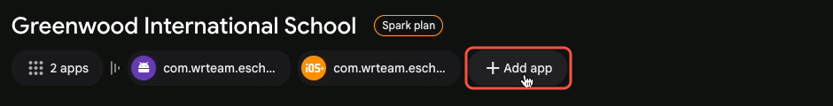

2. Choose the **Android** icon:

   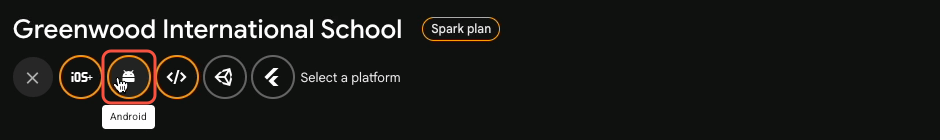

3. In **Android package name**, enter the school's **Android package id** exactly as it is in the builder, for example `com.wrteam.eschool.greenwoodinternationalschool`. The **App nickname** is optional. Click **Register app**.

   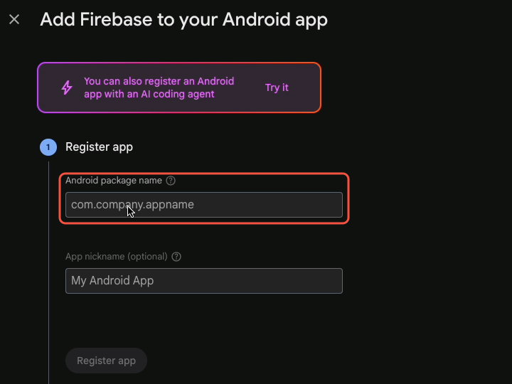

4. Click **Download google-services.json**. The file goes to your **Downloads** folder.

   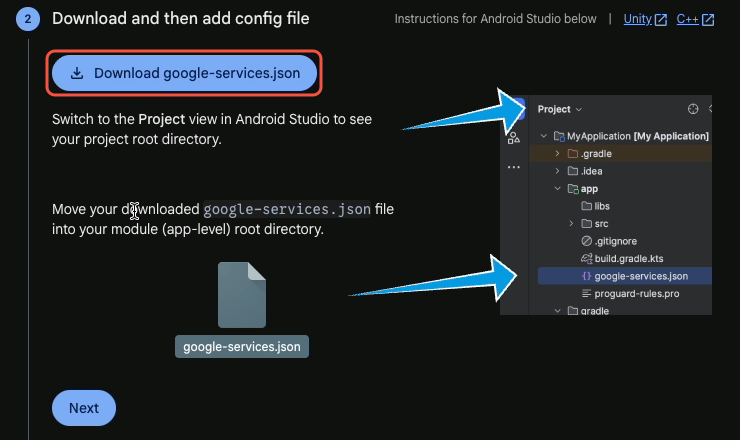

5. Click **Next** on the remaining steps, then **Continue to console**.

:::info Skip Firebase's instructions on this screen
Firebase tells you to move the file into Android Studio and to add the Firebase SDK and Gradle plugin. **Don't do this.** The eSchool SaaS app already includes the SDK, and the builder puts the file in the right place for each school's build. You only need the downloaded file.
:::

:::warning "You already have an app with that package name"
This means the Android app is **already registered** in this project. Don't change the package name to get past the message: an app with a different name doesn't belong to your school's app. Close the window and download the existing app's file instead, as shown in [Where to Find the Files Later](#where-to-find-the-files-later).

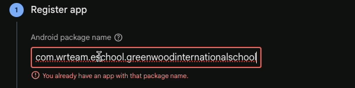
:::

---

## Step 3: Add the iOS App and Download `GoogleService-Info.plist`

Skip this step if you build the school's app for Android only.

1. Go back to **Project Overview** and click **+ Add app** again. This time choose the **iOS** (Apple) icon.
2. In **Apple bundle ID**, enter the school's **iOS bundle id** exactly as it is in the builder. The **App nickname** and **App Store ID** are optional. Click **Register app**.
3. Click **Download GoogleService-Info.plist**.
4. Click **Next** on the remaining steps, then **Continue to console**. Skip Firebase's instructions about Xcode and the SDK: the builder handles them, as for Android.

:::warning iOS notifications also need an APNs key
Apple delivers iOS notifications only when the Firebase project has your **APNs Authentication Key** (`.p8`). Upload it in **Project settings → Cloud Messaging → Apple app configuration**. Each school's own project needs the key uploaded **once**. You can upload the same `.p8` key to every project that uses your Apple Developer account. See [Push Notification Setup](../push-notification-setup.md).
:::

---

## Where to Find the Files Later

You can download both app files again at any time, for example when you set up a new computer:

1. In the left menu, click **Settings** (the gear icon) **→ General**.
2. Scroll down to **Your apps**.
3. Click the app under **Android apps** or **Apple apps**.
4. Click **google-services.json** or **GoogleService-Info.plist**.

Check the **Package name** (Android) or **Bundle ID** (iOS) shown for the app. It must be the school's ID.

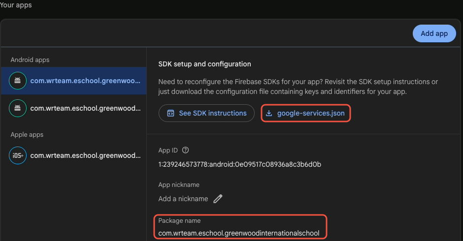

---

## Step 4: Add the Two App Files to the Multi-School APK Builder

1. Start the builder: `.\build.cmd` on Windows, `./build.sh` on macOS. See [Install the Add-on](./install-addon.md#step-3-open-the-builder).
2. In the **Schools** tab, click **Edit** on the school, or **Add school** for a new one.
3. Open the **Firebase** section:
   - Under **Android · google-services.json**, click **Choose file…** and select the downloaded `google-services.json`.
   - Under **iOS · GoogleService-Info.plist**, click **Choose file…** and select the downloaded `GoogleService-Info.plist`.

   You can also drag each file onto its box.
4. Check the **Firebase project** line under each file. Both must show the same project.
5. Click **Save**.

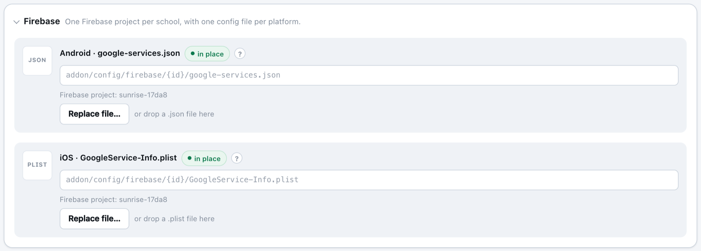

The builder copies both files into the school's own folder, so you can delete the downloaded copies afterwards:

```text
addon/config/firebase/<school-id>/
├── google-services.json        ← Android
└── GoogleService-Info.plist    ← iOS
```

:::tip Without the browser page
You can also copy the two files into that folder yourself. Use the exact file names above, and the school's ID as the folder name. Then run `.\build.cmd --firebase` or `./build.sh --firebase` to list each school's Firebase project.
:::

:::danger Never put the service account file here
The `addon/config/firebase/` folder and the builder are only for `google-services.json` and `GoogleService-Info.plist`. The service account file from Step 5 is a **private key**: it goes only into the admin panel.
:::

---

## Step 5: Connect the Project in the School's Admin Panel

The app files let the app **receive** notifications. The admin panel also needs this project's private key to **send** them.

### 5.1 Copy the Project ID

In Firebase, open **Settings → General** and copy the **Project ID**:

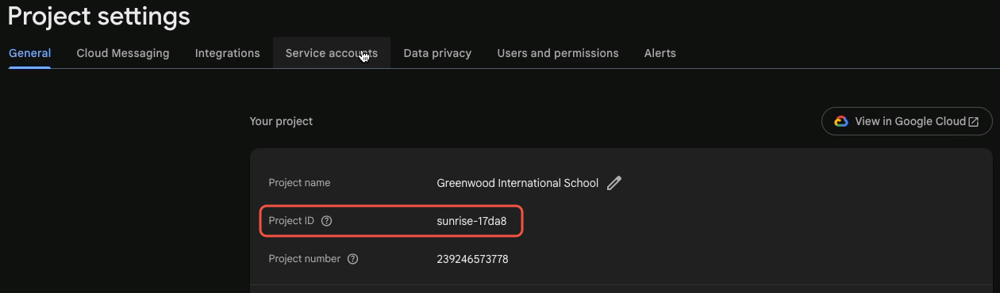

### 5.2 Download the service account file

🎬 **Watch it first** (19 seconds: find the **Project ID** and generate the service account file):

<video controls width="100%" poster="/eSchool-SaaS-Doc/images/installation/app/multi-school-apk/firebase/video-poster-service-account.jpg" style={{borderRadius: '12px', boxShadow: '0 10px 15px -3px rgba(0,0,0,0.1)'}}>
  <source src="/eSchool-SaaS-Doc/video/firebase-service-account-key.mp4" type="video/mp4" />
  Your browser does not support the video tag.
</video>

1. Open the **Service accounts** tab.
2. Make sure **Firebase Admin SDK** is selected on the left, and click **Generate new private key**:

   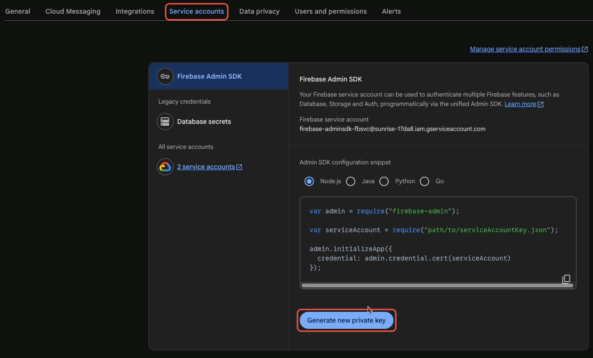

3. Read the warning and click **Generate key**. A `.json` file named like `your-project-id-firebase-adminsdk-xxxxx.json` downloads.

   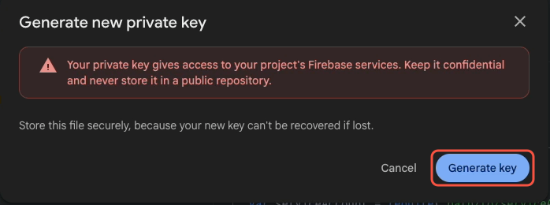

:::danger Keep this file private
The service account file gives full access to the Firebase project. Don't email it, share it in chat, add it to the app or commit it to Git. Firebase can't show it to you again: if you lose it, generate a new key. If it may have been shared, delete that key in **Manage service account permissions** (Google Cloud) and generate a new one.
:::

### 5.3 Enter both in the admin panel

1. Log in to the **school's** admin panel.
2. Go to **Settings → System settings → Notification settings**.
3. In **Firebase project ID**, paste the Project ID from 5.1.
4. Next to **Firebase service file**, click **Upload** and choose the service account file from 5.2. Only `.json` files are accepted.
5. Click **Submit**.

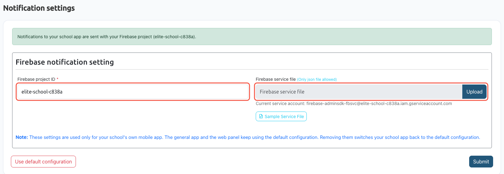

When the setting is saved, the green message at the top of the page names the school's project: *"Notifications to your school app are sent with your Firebase project (…)"*. **Current service account** shows the account from the uploaded file. Its address ends with `@<project-id>.iam.gserviceaccount.com`, so you can check that it's the right project.

:::info What this setting changes
It applies only to the **school's own mobile app**, the one you build for it with this add-on. The general app and the web panel keep using the default configuration from the [Super Admin panel](/superadmin/settings/system-settings/notification-settings).

**Use default configuration** removes the school's own project, and the school's app goes back to the default configuration. Do this only if the school's app is registered in your default Firebase project; otherwise its notifications stop.
:::

---

## Step 6: Build and Test

1. Build the school's app in the builder. See [Generate the APK](./generate-apk.md).
2. Install the app on a phone, log in, and allow notifications when the app asks.
3. From the school's admin panel, send a notification, for example a new announcement, to that user.
4. The notification should arrive within a minute. If it doesn't, see [Troubleshooting](#troubleshooting).

---

## ✅ Checklist

- [ ] One Firebase project for the school, with its **Android** app (and **iOS** app for iOS builds)
- [ ] The package name and bundle ID in Firebase are **exactly** the school's IDs in the builder
- [ ] `google-services.json` and `GoogleService-Info.plist` are in the builder's **Firebase** section, and both show the same project
- [ ] *(iOS)* The APNs key is uploaded in **Cloud Messaging**
- [ ] The school's **Notification settings** have the same project's **Project ID** and **service account file**
- [ ] A test notification arrived on a phone

---

## 🛠️ Troubleshooting {#troubleshooting}

| Problem | Cause | What to do |
|---------|-------|------------|
| The Android build stops with *"No matching client found for package name '…'"* | The school's `google-services.json` doesn't contain its package ID: it was downloaded for another app, or the package ID in Firebase is different. | In Firebase, add (or check) the Android app with **exactly** the school's package ID. Download `google-services.json` again and choose it in the builder. |
| Firebase says *"You already have an app with that package name"* | The app is already registered in this project. | Don't register it again. Download its file from **Settings → General → Your apps**. |
| `Firebase project mismatch between platforms` | The Android and iOS files come from different projects. | Download both files from the same project. |
| The app works, but notifications never arrive | The admin panel uses a different Firebase project from the app's files, or still uses the default configuration. | Compare the project in the green message on **Notification settings** with the **Firebase project** line in the builder. They must be the same. Fix whichever is wrong, then build and install the app again if you changed its files. |
| Notifications arrive on Android but not on iOS | The APNs key isn't uploaded in this project. | Upload the `.p8` key in **Cloud Messaging → Apple app configuration**. See [Push Notification Setup](../push-notification-setup.md). |
| You registered a wrong package name by mistake | A typo in **Register app**. | In **Settings → General → Your apps**, select the wrong app, scroll to the bottom and click **Remove this app**. Then register the correct one. |
| **Notification settings** in the school's admin panel has no Firebase fields | The admin panel is older than this feature. | Update the admin panel to the latest version. |

For other builder messages, see [Troubleshooting & FAQ](./troubleshooting.md).

Next: [Add a School](./add-a-school.md), or [Generate the APK](./generate-apk.md) if the school is already added.
