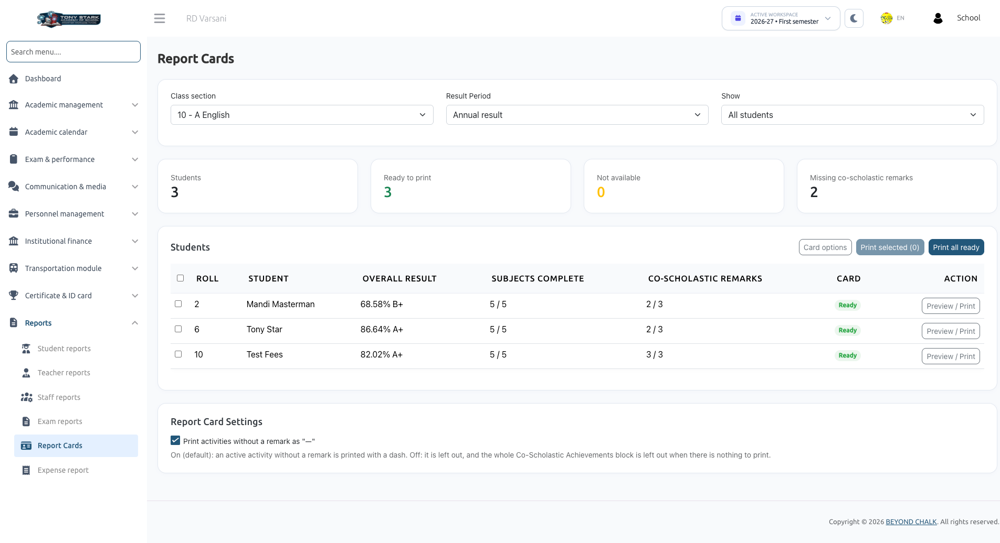
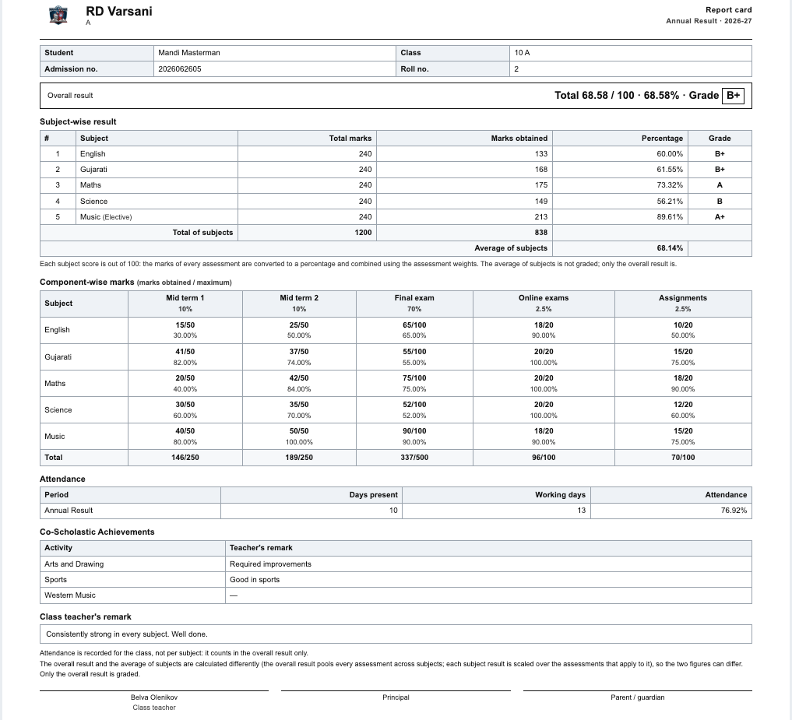
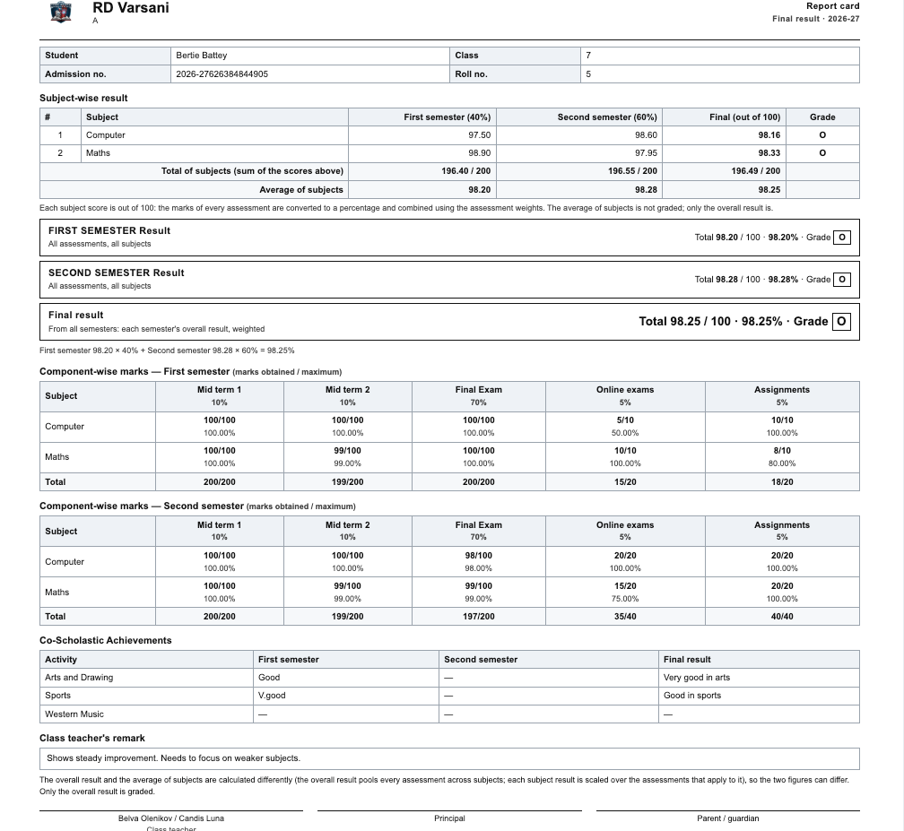

# Report Cards

The **Report Cards** module (located under **Reports &rarr; Report Cards**) compiles students' weighted academic scores, subject evaluations, attendance records, and teacher remarks into standardized, printable report cards.

Report cards are generated in clean, high-resolution **A4 landscape** format suitable for official school distribution, parent-teacher conferences, and digital PDF downloads.

:::info Access & Visibility
- **School Admin**: Can generate and print report cards for any class section across the school.
- **Class Teacher**: Can generate and print report cards for students enrolled in their assigned section(s).
- **Report Card Requirement**: A report card is **only produced when a student's result is complete**. Final report cards require that both the Final result and all constituent semester results are complete. Cards are never printed partially filled.
:::

---

## 1. Generating & Filtering Report Cards

Navigate to **Reports &rarr; Report Cards**.

1. Select your target **Class section** and **Result Period** (e.g., *Annual Result*, *First Semester*, *Second Semester*, or *Final Result*).
2. Use the **Show** filter to segment students:
   - **All students**: Lists every enrolled student in the section.
   - **Ready to print**: Displays students with complete results ready for printing.
   - **Not available**: Displays students whose results cannot be printed yet (along with the specific blocker, e.g., *result incomplete*).
   - **Missing co-scholastic remarks**: Identifies students lacking co-scholastic evaluations.

### Table Columns & Indicators
- **Student Information**: Name, Admission number, and Roll number.
- **Overall Result**: Cumulative percentage and letter grade.
- **Subjects Complete**: Counter showing completed versus total subjects (e.g., *5 / 5*).
- **Co-Scholastic Remarks**: Tally of completed activity remarks (e.g., *3 / 4*).
- **Card Status**: Indicates if the card is **Ready**, **Published**, or why it is blocked.
- **Actions**: Preview single card, or select multiple rows for batch printing.

---

## 2. Card Customization Options

Click **Card options** to toggle specific sections of the report card on or off:
- **Component-wise Marks Table**: Detailed breakdown of marks obtained per subject under each component.
- **Attendance Summary**: Days present, total working days, and attendance percentage.
- **Co-Scholastic Achievements**: Extracurricular activities and written remarks.
- **Class Teacher's Remark**: Written qualitative evaluations.
- **Print Empty Activities as "—"**:
  - *On (Default)*: An active assigned activity with no written remark prints with a standard dash ("—").
  - *Off*: Unremarked activities are omitted entirely; if no activities have remarks, the entire Co-Scholastic Achievements section is omitted from the card.

---

## 3. Printing Workflow & PDF Generation

1. **Single Student Print**: Click the **Preview / Print** button on any student's row.
2. **Batch Printing**: Tick specific student checkboxes and click **Print selected**, or click **Print all ready** to generate cards for the entire section.
3. **Pre-Flight Summary**: A **Before you print** dialog confirms:
   - Total cards to be rendered.
   - Number of skipped students and exact reasons (e.g., pending marks).
   - Count of students missing co-scholastic remarks.
4. **Browser Print Dialog**: Click **Print / Save as PDF**. The document renders in a new browser tab formatted for **A4 Landscape**. Use your browser's print utility to send to a physical printer or save as a digital PDF.

---

## 4. Report Card Anatomical Breakdown

### Annual Report Card Layout

### Semester / Final Report Card Layout

A fully rendered report card contains the following standard sections:

| Section | Content & Structure |
| :--- | :--- |
| **School Header** | School crest/logo, institution name, address, **REPORT CARD** header, academic session, and result period. |
| **Student Metadata** | Student full name, Class & Section, Admission number, and Roll number. |
| **Overall Result Box** | Displays total obtained marks over maximum marks, overall percentage, and letter grade (e.g., *Total 68.58 / 100 · 68.58% · Grade B+*). On Final cards, displays separate summary boxes for each semester alongside the cumulative **FINAL RESULT**. |
| **Subject-Wise Results** | Tabular summary listing **Subject**, **Total marks**, **Marks obtained**, **Percentage**, and **Grade** per subject, concluded with **Total of subjects** and **Average of subjects**. On Final cards, displays semester columns with weightages (e.g., *Sem 1 (40%)*, *Sem 2 (60%)*) leading to the *Final (out of 100)* column. |
| **Component-Wise Marks** | Comprehensive matrix detailing marks obtained versus maximum for every offline exam, online exam, and assignment group. |
| **Attendance Record** | Displays days present, total school working days, and calculated attendance percentage. |
| **Co-Scholastic Achievements** | Extracurricular disciplines (Sports, Art, Music, Leadership) accompanied by teacher remarks. |
| **Class Teacher's Remark** | Qualitative assessment and encouragement written by the class teacher. |
| **Signatures & Footnotes** | Official signature lines for the *Class Teacher*, *Principal*, and *Parent / Guardian*. |

### Footnote Markers
- **\*** (*Asterisk*): Some assessment components do not evaluate this subject; weights have been proportionally rescaled to 100%.
- **†** (*Dagger*): Student was marked absent and scored zero according to assessment rules.
- **‡** (*Double Dagger*): Student was granted an administrative exemption with a documented reason.
- **§** (*Section Sign*): Subject was offered in only one semester; its Final score reflects that semester alone.

---

## 5. Mobile App PDF Downloads

Once results are published by the School Admin:
- Students and parents can view their results on the mobile application.
- The app includes a direct download link to save the exact same official **Report Card PDF** to their smartphones.
- Class Teachers using the **Teacher App** can also view consolidated results, record student remarks, and preview report card PDFs on mobile devices.

---

## Related Documentation
- [Result Assessments Overview](../result-assessment/overview.md): Comprehensive feature guide and permissions.
- [Assessments Setup](../result-assessment/assessments.md): Define components, exams, and weightages.
- [Consolidated Results](../result-assessment/consolidated-results.md): Review student scores and manage overrides.
- [Student Remarks](../result-assessment/student-remarks.md): Record teacher feedback and co-scholastic observations.
