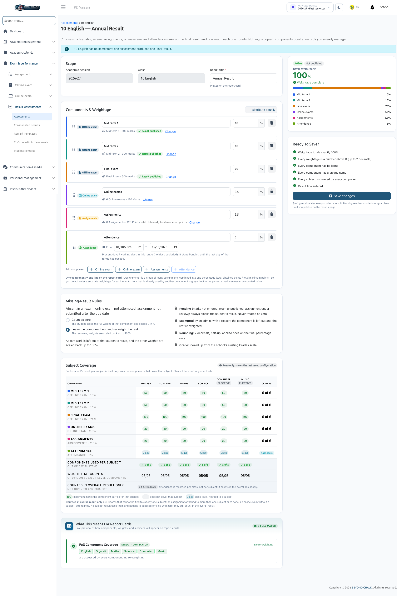
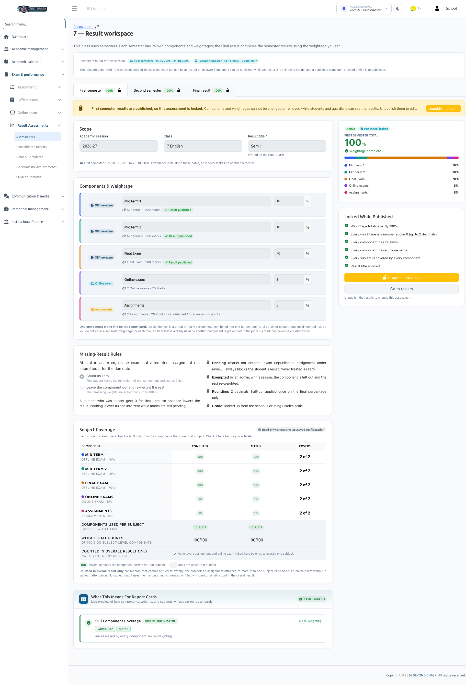

# Assessments Setup

The **Assessments** module is where School Administrators design the weighted evaluation structure for each class. You determine which examinations, assignments, online tests, and attendance periods contribute to student results, and allocate their percentage weightages.

:::info Permissions & Scope
Only users with the `result-assessment-list`, `result-assessment-create`, and `result-assessment-edit` permissions (typically the **School Admin** role) can configure assessments. Assessments are scoped to the active **Session Year**.
:::

---

## 1. Assessments Dashboard & Filters

Navigate to **Exam & Performance &rarr; Result Assessments &rarr; Assessments**.

### Metric Summary Cards
- **Classes**: Total classes in the active session year.
- **Active assessments**: Assessments currently calculating marks.
- **Drafts that need attention**: Assessments in draft state or missing configuration items.
- **Classes not set up**: Classes that have not yet had assessments configured.

### Filters & Search
Filter the table by:
- **Class**: Select a specific class.
- **Result Period**: Filter by *All*, *Annual*, *Final Result*, or individual *Semester results*.
- **Status**: Filter by *Active*, *Draft*, or *Not set up*.
- **Search**: Search by class name or custom assessment title.

### Assessment Row Actions
Click the three-dots (**...**) action menu on any class to access:
- **Results**: Opens Consolidated Results for this assessment.
- **Edit**: Opens the assessment builder (or **View (locked)** if published).
- **Recalculate**: Re-runs marks calculation across all students against current system data.
- **Activate / Move back to draft**: Toggles the assessment between active calculation and draft status.
- **Duplicate**: Clones the assessment structure to another class.
- **Delete**: Permanently removes the assessment definition (requires typing the title to confirm).

---

## 2. Setting Up a Class Without Semesters (Annual Result)

For classes that do not use semesters, a single assessment produces the final annual outcome:

1. Click **Set up** on the target class. The builder is titled **Annual Result** (*"[Class] has no semesters: one assessment produces one Final Result"*).
2. Enter the **Result title** (e.g., *Annual Result 2026-27*). This label prints at the top of the report card.
3. Add components and assign percentage weightages totaling **exactly 100%**.
4. Configure missing-result rules.
5. Review the **Subject coverage** table on the right.
6. Click **Save & activate**.

---

## 3. Setting Up a Class With Semesters (Result Workspace)

When a class uses semesters, click **Open workspace**. The workspace contains a tab for each session semester plus a dedicated **Final result** tab:

- **Independent Semester Tabs**: Each semester tab (e.g., *First semester*, *Second semester*) acts as an independent assessment with its own components and weightages. Each can be activated and published separately (e.g., *First semester* can be published to parents while *Second semester* is still ongoing).
- **Copy Structure from [Semester]**: Quick-action button that pre-fills component names, types, and weightages from another semester. You only need to select the new semester's items.

### Final Result Tab
.png)

The **Final result** tab combines the semester assessments into a cumulative yearly result:
- Enter the **Semester weightage** split (for example, *First semester 40%, Second semester 60%*). The split must total 100%.
- **Activation Prerequisite**: The Final result can only be activated when **every constituent semester is already active**.

---

## 4. Adding & Configuring Components

Click **Add component** and select a component type:

| Component Type | Source Items & Behavior |
| :--- | :--- |
| **Offline exam** | Select one or more physical exams belonging to this class and session/semester. |
| **Online exam** | Select one or more online exams placed in a section of this class. |
| **Assignments** | Select a collection of assignments. They combine automatically into a single percentage: `(Total points obtained ÷ Total maximum points) × 100`. No individual assignment weightages are needed. |
| **Attendance** | Define a date range (**From / To**). For semester classes, defaults to the semester's date bounds. Only **one** Attendance component is permitted per assessment. |

### Component Settings
For each added component:
- **Component name**: Unique name displayed on report cards (e.g., *Mid Term 1*, *Periodic Tests*, *Term Examination*).
- **Weightage (%)**: Enter a percentage value greater than 0, up to 100 (up to 2 decimals). Quick helper buttons:
  - **Distribute equally**: Splits 100% evenly among all components.
  - **Put remainder in last**: Automatically balances rounding differences into the last component.
- **Select items**: Click to open the item drawer, select the exams or assignments, and click **Apply selection**.
- **Reordering**: Drag components by their handles to rearrange them. This order is preserved on screen and on printed report cards.

:::warning Item Selection Restrictions
An item may appear greyed out in the picker for the following reasons:
- *"Used in '[component]'"*: An exam, assignment, or online test can only be used by **one** component in an assessment.
- *"No points set: not gradable"*: The assignment lacks maximum points.
- *"No timetable: cannot be selected"*: The offline exam lacks a scheduled timetable.
:::

---

## 5. Missing-Result Rules

Under **Missing-result rules**, define how unrecorded marks are handled:

- **Count as zero (Default)**: The student retains the full weightage of that component and receives a score of 0.
- **Leave the component out and re-weight the rest**: The unattempted component is removed for that student, and remaining components are proportionally scaled back up to 100%.

### Standard Invariant Rules
- **Pending**: Always pauses calculation for that student; pending items are **never counted as zero**.
- **Exempted**: Set manually by administrators with a mandatory documented reason.
- **Rounding**: Computed to 2 decimal places using half-up rounding, applied once on the final score.
- **Grading**: Derived directly from the school's configured Exam Grade scale.

---

## 6. Subject Coverage Verification & Activation

The right-hand summary panel displays the **Ready to activate?** checklist and the **Subject coverage** table:

- **Uncovered Subject Alert**:  
  *`"[Subject] is not covered by any component, so it will not appear on report cards."`*  
  Add or modify components to include exams covering that subject.
- **Rescaled Subject Notice**:  
  *`"Its result uses the weights … scaled to 100%. It is marked * on report cards."`*  
  Indicates that certain components do not assess this subject, so its existing components are normalized to 100%.
- **Class-Level Items**: Non-subject components (like Attendance) and multi-subject online tests contribute to the **overall** score only, never to individual subject scores.

### Activation Requirements
Clicking **Save & activate** validates that:
1. An assessment title is provided.
2. At least one component exists with a unique name.
3. Every component has a weightage greater than 0%.
4. Every component has at least one linked item (or valid date range for Attendance).
5. All component weightages sum to **exactly 100.00%**.

Once activated, background calculation begins immediately for all enrolled students.

---

## 7. Editing a Published Assessment

When an assessment is published to students and parents, it is **locked** to prevent unintended data discrepancies.

To make structural edits to a published assessment:
1. Open the assessment and click **Unpublish to edit...**.
2. Confirm the action by clicking **Unpublish and edit**.
3. Mobile app access is temporarily paused for parents and students.
4. Apply your adjustments, verify calculations on Consolidated Results, and re-publish.

---

## Next Steps
Once an assessment is active, review calculated scores and manage student exceptions in [Consolidated Results](./consolidated-results.md).
