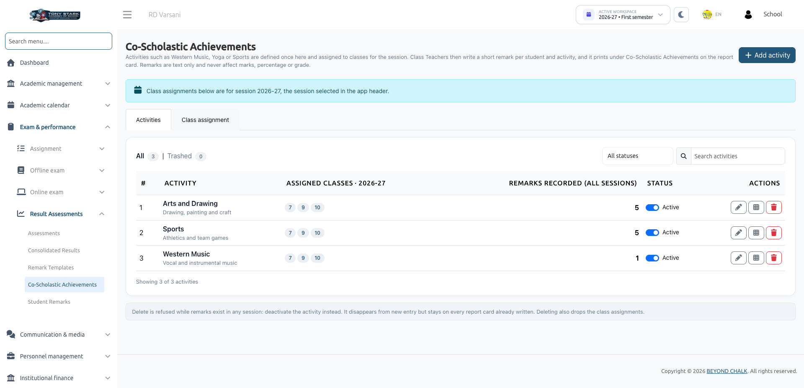
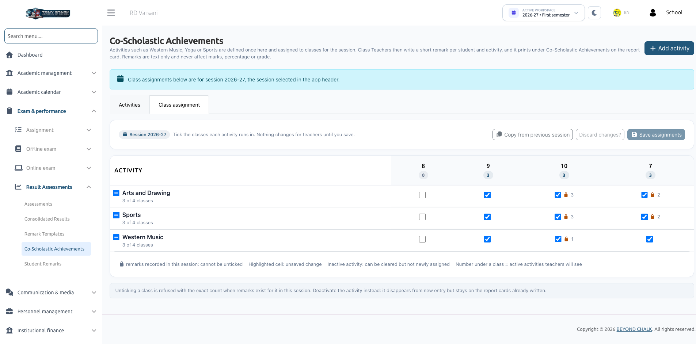

# Co-Scholastic Achievements

**Co-Scholastic Achievements** evaluates students in holistic, non-academic disciplines such as Sports, Art & Craft, Music, Yoga, Environmental Studies, and Leadership. Rather than numerical scores, students receive descriptive teacher remarks (e.g., *Sports: Exemplary team captain; excellent athletic endurance*) that print directly on their report cards.

:::info Scope & Permissions
Configuring co-scholastic activities and their class mappings is managed by School Administrators using the `co-scholastic-activity-list`, `co-scholastic-activity-create`, and `co-scholastic-activity-edit` permissions.
:::

---

## 1. Activities Tab: Defining Activities

Navigate to **Exam & Performance &rarr; Result Assessments &rarr; Co-Scholastic Achievements**.

### Creating an Activity
1. On the **Activities** tab, click **+ Add activity**.
2. Enter the **Activity name** (up to **100 characters**; must be unique among active activities).
3. Optionally enter a **Description** (up to **255 characters**).
4. Ensure the **Active — class teachers can enter remarks** checkbox is ticked.
5. Click **Save activity**.

### Activity Table Columns
- **Activity Name & Description**: Title printed on report cards.
- **Assigned Classes**: Total classes offering this activity for the active session.
- **Remarks Recorded (All Sessions)**: Total remarks entered across the entire school history.
- **Status**: Active or Inactive.
- **Actions**: Edit, Deactivate, or Delete.

---

## 2. Class Assignment Tab: Mapping to Classes

Activities must be assigned to specific classes for the current academic session:

1. Switch to the **Class assignment** tab.
2. The interactive matrix displays all activities down the left column and classes across the top.
3. Tick the checkboxes for the classes in which each activity is conducted.
4. Click **Save assignments**.

:::tip Reusing Last Year's Assignments
Click **Copy from previous session** to automatically replicate class mappings from the previous academic year. This copies the assignment structure only; individual student remarks are never copied.
:::

---

## 3. Activity Lifecycle & Safety Rules

- **Deactivating an Activity**: If an activity is suspended or discontinued, set its status to **Inactive**. This prevents teachers from entering new remarks, while preserving all historical remarks already recorded on student report cards.
- **Deletion Protection**: An activity **cannot be deleted** if any student remarks are attached to it in any academic session. Administrators must deactivate it instead.
- **Trash & Restore**: Deleted activities without remarks move to **Trashed** and can be restored (provided no new activity has taken the name).
- **Renaming Warnings**: Renaming an activity modifies the label printed on all historical and upcoming report cards. The system requires explicit confirmation before saving a rename.
- **Class Un-mapping Safeguard**: You cannot uncheck a class for an activity if any student in that class has already received a remark in the active session.

---

## Next Steps
Class teachers can enter remarks for assigned activities in [Student Remarks](./student-remarks.md).
