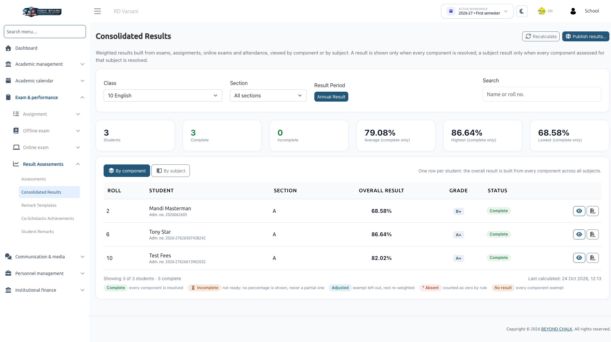
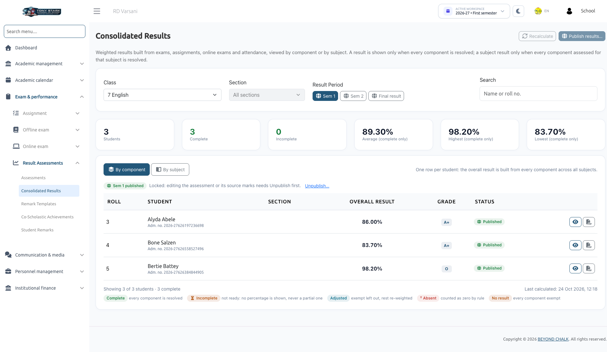
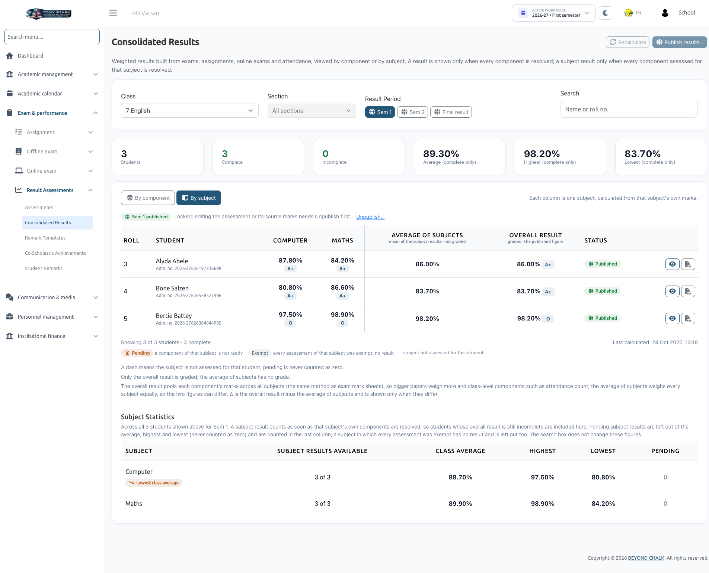
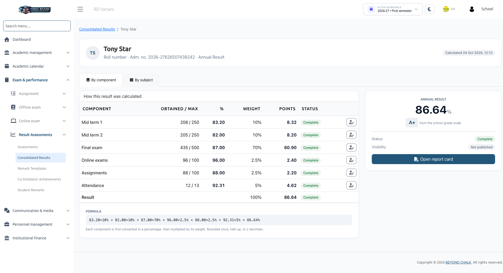
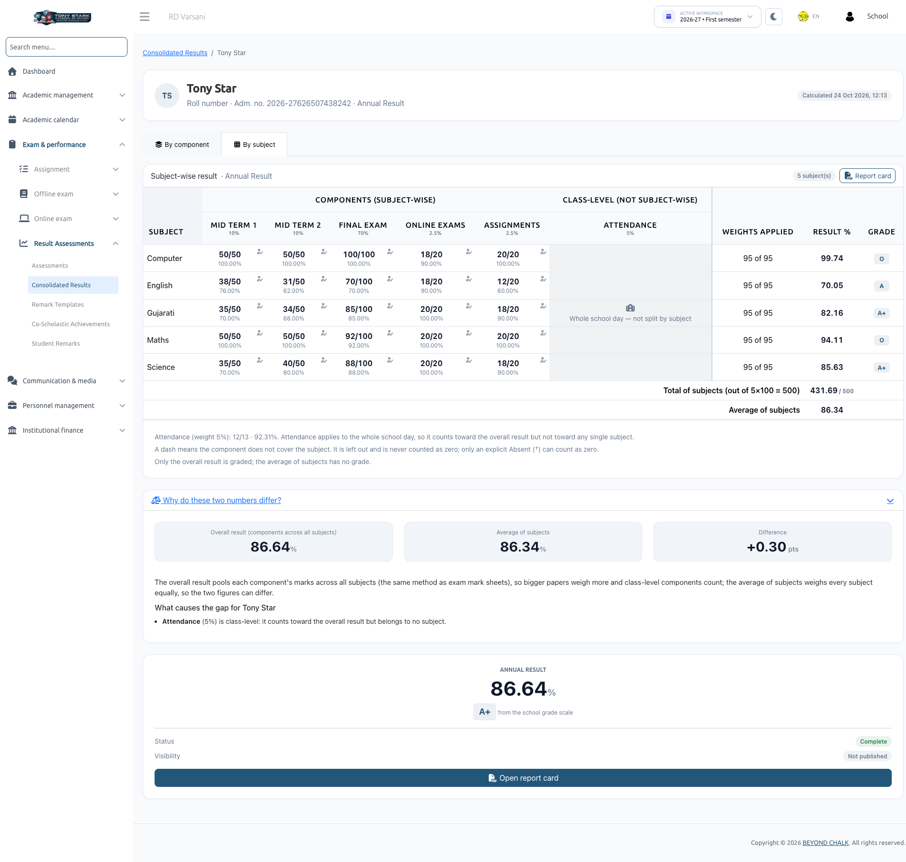

# Consolidated Results

**Consolidated Results** is the central review dashboard where administrators and class teachers inspect computed student results, examine component-level and subject-level score breakdowns, handle absent/exempt exceptions, and publish results.

:::info User Permissions
- **School Admin**: Full access to view, recalculate, mark students absent/exempt, publish, and unpublish results.
- **Class Teacher**: Can view consolidated results and student breakdowns for their assigned class section(s) in read-only mode.
:::

---

## 1. Navigating Consolidated Results

Open **Exam & Performance &rarr; Result Assessments &rarr; Consolidated Results**.

1. Select the **Class**, **Section**, and **Result Period** (e.g., *Annual Result*, *First Semester*, or *Final Result*).
2. Use the search bar to locate students by **Name**, **Roll number**, or **Admission number**.
3. Toggle between the two analytical views:
   - **By component**: Displays one row per student with columns for each defined assessment component (percentage), followed by the **Overall result**, **Grade**, and **Status**.
   - **By subject**: Displays one column per academic subject, derived exclusively from each subject's individual assessments.

### Summary Statistics
At the top of the grid, real-time metrics summarize cohort performance:
- **Enrollment Counts**: Total enrolled students, Complete count, Incomplete count, and No result (all exempt).
- **Academic Benchmarks**: Class **Average**, **Highest**, and **Lowest** percentages.  
  *(Note: Averages include completed results only; incomplete students are never averaged in as 0).*
- **Subject Statistics**: Displays average, maximum, and minimum scores per subject.

---

## 2. By Subject View

Switch to **By subject** to evaluate subject-specific performance across the section:
- Each subject shows the student's percentage and letter grade.
- **Dash (—)**: Indicates an elective or non-applicable subject that the student does not take. It is never treated as zero.
- **Pending**: Indicates that marks for this specific subject are awaiting publication or review.
- Subject results become available as soon as their own components are resolved, even if other subjects or class-level components for that student are still incomplete.

---

## 3. Student Statuses & Visual Markers

| Status | Meaning & Calculation Impact |
| :--- | :--- |
| **Complete** | Every required component is resolved. The overall percentage and letter grade are displayed. |
| **Incomplete** | At least one component is pending. **No overall percentage is displayed** (never a partial estimate). The row specifies what is pending (e.g., *"Waiting for 2: Online exams, Assignments"*). |
| **No result** | Every component was marked exempt, leaving no data to compute. The School Admin must review exemptions. No grade is assigned (never 0% or "F"). |
| **Not calculated** | The assessment is still in draft mode, or has not been recalculated since this student enrolled. |

### Diagnostic Markers
- **Adjusted**: An exempt or unattempted item was omitted and remaining weights were rescaled to 100%.
- **Absent counted as 0**: The student missed an exam or assignment and scored zero according to assessment rules.
- **Absent · left out**: The student was absent and the component was excluded from their total.
- **Out of date**: Marks, attendance, or assignments changed after calculation. The page displays:  
  *`"Source marks changed after the last calculation. Results below may be out of date."`*  
  Click **Recalculate now** to refresh scores.
- **Draft**: The parent assessment is still a draft and requires activation.

---

## 4. Student Breakdown Drill-Down

Click any student's name to open their **Student breakdown** drawer:

### Component Breakdown Tab

- **How this result was calculated**: Lists each component with its **Obtained / Max marks**, **Weight %**, **Weighted Points**, and **Calculation Formula**.
- **Class-Level Items**: Details attendance calculations (days present / working days).

### Subject Breakdown Tab

- **Subject-wise result**: Displays marks obtained across components for each subject, complete with subject totals, averages, and pending alerts.
- **Why do these two numbers differ?**: Explains discrepancies between the Overall Result and the Average of Subjects (e.g., varying paper sizes, attendance inclusion, or re-weighted components).

---

## 5. Setting Administrative Overrides (Absent & Exempt)

If a student missed an examination due to illness or approved leave:

1. In the Student Breakdown, click **Set status &rarr; Set component status**.
2. Configure the override:
   - **Apply to**: Choose **This subject only** or **Whole component (all subjects)**.
   - **Status**:
     - **Absent**: Applies the assessment's missing-result rule (0% or omitted).
     - **Exempt**: Omits the item and rescales remaining weights to 100%. A **Reason** is mandatory (e.g., *Medical leave approved by Principal*).
3. Click **Save & recalculate**.

:::note Handling Absent Offline Exams
Offline exam registers cannot natively store an "absent" mark. An absent student will show as **Pending** in Consolidated Results until an administrator explicitly records their status as **Absent** or **Exempt** here.
:::

---

## 6. Publishing Results

When marks and remarks are finalized, the School Admin publishes results to students and parents:

1. On Consolidated Results, select the Class and Result Period.
2. Click **Publish results...**.
3. The system performs an automatic pre-publish recalculation and presents a summary:
   - *`"34 result(s) will be published."`*
   - *`"2 will be skipped because they have no complete result"`* (with their names listed).
4. Click **Confirm & publish**.

### Important Publishing Rules
- **Whole-Class Scope**: Publishing applies across all sections of the class for that period.
- **Only Complete Results**: Incomplete students are skipped and will not see partial results in mobile apps.
- **Frozen Snapshot**: Publishing creates a locked snapshot. Future edits to exams or marks will not alter published results unless an administrator explicitly chooses to **Unpublish &rarr; Recalculate &rarr; Publish**.
- **Final Result Precedence**: To unpublish a semester that forms part of a published Final Result, you must **unpublish the Final Result first**.

---

## Next Steps
Class teachers can add personalized feedback in [Student Remarks](./student-remarks.md) and print final copies in [Report Cards](../reports/report-cards.md).
