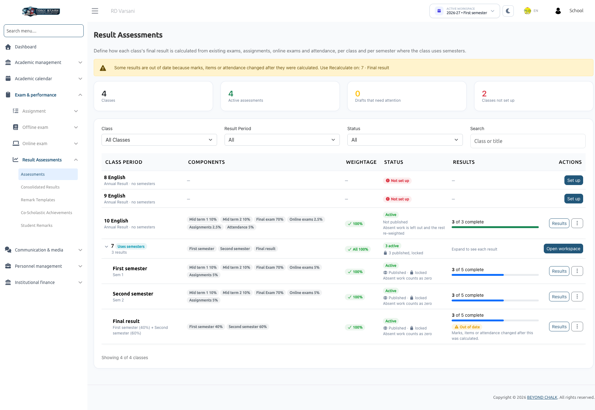
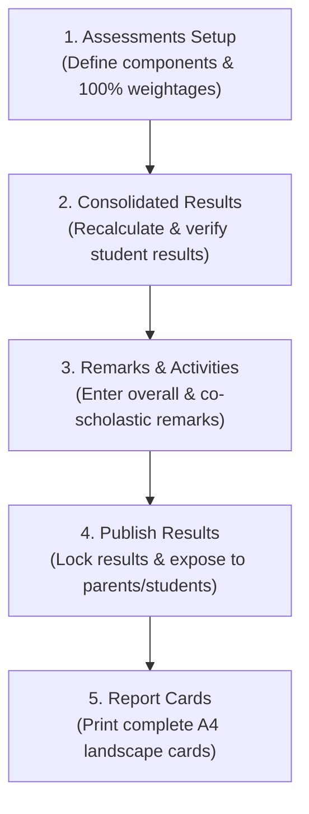

# Result Assessments Overview & Guide



**Result Assessments** compiles the marks, assignments, online exams, and attendance you already manage in the school system into a single **weighted result per student**, and outputs professional, print-ready **Report Cards**.

Administrators decide which offline exams, online exams, assignments, and attendance records count towards a class's result, and assign a percentage weightage to each (for example, *Mid term 10%, Final exam 70%, Assignments 10%, Attendance 10%*).

The system then:
1. Calculates every student's result automatically, both overall and subject-by-subject.
2. Displays the outcomes on **Consolidated Results**, highlighting pending items whenever a result cannot be finalized yet.
3. Enables Class Teachers to add written **remarks** (an overall evaluation and specific **Co-Scholastic Achievements** remarks like *Sports: Very Good*).
4. Allows School Admins to **publish** results for parents and students to view in mobile apps.
5. Generates comprehensive **Report Cards** in standard A4 landscape format for individual students or entire sections.

:::info Non-Destructive Calculation
Result Assessments reads directly from existing exams, marks, assignments, online tests, and attendance registers. It never alters or duplicates underlying academic records.
:::

---

## 1. Roles & Permissions: Who Does What

| Role | Menu Access | Capabilities & Limitations |
| :--- | :--- | :--- |
| **School Admin** | *Exam & Performance &rarr; Result Assessments &rarr;* **Assessments**, **Consolidated Results**, **Remark Templates**, **Co-Scholastic Achievements**, **Student Remarks**; *Reports &rarr;* **Report Cards** | **Full Access**: Set up assessments, define weightages, recalculate, publish/unpublish, grant absent/exempt overrides, manage remark templates and co-scholastic activities, write remarks for any section, and print all report cards. |
| **Class Teacher** (Teacher assigned to a section) | **Consolidated Results**, **Remark Templates** (read-only), **Student Remarks**; *Reports &rarr;* **Report Cards** | View results of their assigned section(s), enter overall and co-scholastic remarks, and print section report cards. A Class Teacher **cannot** configure assessments, publish, recalculate, or alter weighting rules. |
| **Subject Teacher** (Not class teacher for that section) | **Student Remarks** | Can view section remarks in **read-only** mode. Cannot view students' overall consolidated results. |
| **Students & Parents** | Mobile Applications | Can view **published** results and download Report Card PDFs once released by administrators. |

:::tip Key Access Principles
- Teachers only have access to sections where they are assigned as **Class Teacher** for the session. Accessing other sections displays *"Outside your section"*.
- All operations apply to the **Academic Session and Semester** selected in the top workspace bar. Past sessions are archived as read-only.
:::

---

## 2. Before You Start Checklist

Before setting up assessments, verify the following prerequisites:

| Item | Requirement & Purpose |
| :--- | :--- |
| **Exam Management Add-on** | The school's subscription package must include Exam Management. Without it, pages prompt *"Purchase Exam Management to Continue using this functionality"*. |
| **Classes, Sections & Semesters** | Classes, sections, and (for semester-based classes) semesters must be created. If a class uses semesters but none are created, the system alerts you. |
| **Class Teacher Assignments** | Every class section must have assigned Class Teachers in *Academic Management &rarr; Academics &rarr; Class Section and Teachers*. |
| **Published Exams & Marks** | Offline exams must have an established timetable, and their marks must be uploaded with status **Published**, with the exam itself published. Draft marks keep students in a **Pending** status. |
| **Gradable Assignments** | Assignments must have maximum points defined. Assignments without points cannot be graded (*"No points set: not gradable"*). |
| **Attendance Records** | Attendance must be recorded for working days within the selected date range. |
| **Exam Grade Scale** | Ensure your grading bands are configured under *Exam & Performance &rarr; Offline exam &rarr; Exam grade*. Grades on result sheets and report cards derive directly from this scale. |

---

## 3. Key Terminology

| Term | Definition |
| :--- | :--- |
| **Assessment** | The blueprint defining how results are computed for a class: its components and their respective weightages. |
| **Result Period** | The scope of the evaluation: **Annual Result** (for non-semester classes), **Semester Result** (e.g., *First Semester*), or **Final Result** (combines semester results). |
| **Component** | A constituent part of a result appearing as a row/column, such as *Mid Term Exam*, *Online Exams*, *Assignments*, or *Attendance*. In a Final Result, the components are the semesters. |
| **Weightage** | The percentage value of a component towards the total score. Component weightages must add up to **exactly 100%**. |
| **Overall Result** | The cumulative weighted percentage across all subjects and class-level components, paired with an overall **Grade**. |
| **Subject Result** | The student's percentage in an individual subject, calculated solely from the components covering that specific subject. |
| **Draft / Active / Published** | **Draft**: Under configuration; no calculations performed. <br/>**Active**: Results are calculated and visible to authorized staff. <br/>**Published**: Results are locked and made visible to parents and students. |
| **Pending** | Required marks that have not yet been finalized (e.g., unpublished marks, pending assignment reviews). Pending is **never treated as zero**; it pauses calculation for that student until resolved. |
| **Absent** | A missed exam or unsubmitted assignment after the due date. Evaluated based on missing-result rules (**Count as zero** or **Leave out and re-weight**). |
| **Exempt** | An administrative override excusing a student from a component with a documented reason. The component is omitted and remaining weights are scaled back to 100%. |
| **Class-Level Component** | A non-subject component (specifically **Attendance**) that factors into the overall percentage but not individual subject results. |
| **Co-Scholastic Achievements** | Non-academic activities (e.g., *Sports, Music, Art, Conduct*). Evaluated through descriptive teacher remarks without numerical marks. |

---

## 4. End-to-End Workflow


The complete lifecycle of Result Assessments flows through five dedicated modules:



1. **[Assessments](./assessments.md)**: School Admin configures components, selects exams/assignments/attendance, sets weightages to 100%, and activates the assessment.
2. **[Consolidated Results](./consolidated-results.md)**: System computes marks. Admins and Class Teachers review scores by component or by subject, resolve pending items, or grant absent/exempt overrides.
3. **[Remark Templates](./remark-templates.md)** & **[Co-Scholastic Achievements](./co-scholastic-achievements.md)**: School Admin manages ready-made comment banks and assigns extracurricular activities to classes.
4. **[Student Remarks](./student-remarks.md)**: Class Teachers submit overall evaluations and co-scholastic performance remarks.
5. **[Report Cards](../reports/report-cards.md)**: Admins and teachers generate, preview, and print unified report cards.

---

## 5. How Results Are Calculated

### Overall Weighted Calculation
1. **Component Percentage**: All marks inside a component across its covered subjects are totaled:  
   ```text
   Component Percentage = (Total Marks Obtained ÷ Total Maximum Marks) × 100
   ```  
   *(Higher-mark papers naturally carry proportional weight inside the component).*
2. **Weighted Points**: Each component percentage is multiplied by its assigned weightage percentage.
3. **Cumulative Sum & Rounding**: The weighted points are summed and rounded **once**, to 2 decimal places using standard half-up rounding. The final percentage maps to the school's **Exam Grade** scale.

#### Example Calculation
| Component | Obtained / Max | Percentage | Weightage | Weighted Points |
| :--- | :--- | :--- | :--- | :--- |
| **Mid Term 1** | 200 / 200 | 100.00% | 10% | 10.00 |
| **Mid Term 2** | 199 / 200 | 99.50% | 10% | 9.95 |
| **Final Exam** | 500 / 500 | 100.00% | 70% | 70.00 |
| **Online Exams** | 75 / 100 | 75.00% | 5% | 3.75 |
| **Assignments** | 90 / 100 | 90.00% | 5% | 4.50 |
| **Overall Result** | — | — | **100%** | **98.20% (Grade O)** |

### Overall Result vs. Average of Subjects
On student breakdowns and report cards, two numbers may appear:
- **Overall Result**: Calculated component-by-component across all marks and class-level attendance. This is the **official, graded, published figure**.
- **Average of Subjects**: The simple arithmetic mean of individual subject percentages. This is **not graded** and displays only when every subject has a complete result.
- *Why they may differ*: Larger examination papers have greater impact in overall component aggregation, attendance is excluded from subject marks, and subject weightings may be rescaled if certain exams do not cover all subjects.

---

## 6. What Students & Parents See

- **Publish Gate**: Students and parents only see results once the School Admin explicitly clicks **Publish results**. Incomplete results are withheld until fully resolved.
- **Mobile Access**: Results are visible in the school's mobile applications, categorized by semester or as an annual result.
- **Report Card PDF**: Parents and students can download the official Report Card PDF directly to their mobile devices.

---

## 7. Troubleshooting & Common Questions

| Issue | Root Cause | Resolution |
| :--- | :--- | :--- |
| **Student status is "Incomplete"** | A component is **Pending** (e.g., draft exam marks, unreviewed assignments, open online exams). | Check the student breakdown to identify the pending item. Finalize marks at the source, then click **Recalculate**. |
| **Student stuck on Offline Exam** | The student was absent or marks were left blank. | Offline exams cannot natively store "absent". The School Admin must open the student breakdown and set the status to **Absent** or **Exempt**. |
| **"Weightages must total exactly 100%"** | Component percentages do not equal 100%. | Adjust component weights or click **Distribute equally** in the assessment builder. |
| **"Outside your section"** | A teacher attempted to open a class they do not manage as Class Teacher. | Teachers must select their assigned class section from the dropdown. |
| **Results marked "Out of date"** | Source marks, assignments, or attendance changed after calculation. | School Admin must click **Recalculate now** (if published, unpublish first). |
| **Report card shows "Not available"** | The result is incomplete, all components are exempt, or the period is not set up. | Complete all pending items and recalculate the assessment. |

---

## Navigation Links
- [Assessments Setup](./assessments.md): Configure components, items, and weightages.
- [Consolidated Results](./consolidated-results.md): Analyze student scores, handle overrides, and publish results.
- [Remark Templates](./remark-templates.md): Create reusable evaluation remarks.
- [Co-Scholastic Achievements](./co-scholastic-achievements.md): Manage non-academic activities.
- [Student Remarks](./student-remarks.md): Enter teacher remarks for students.
- [Report Cards](../reports/report-cards.md): Print official student report cards.
