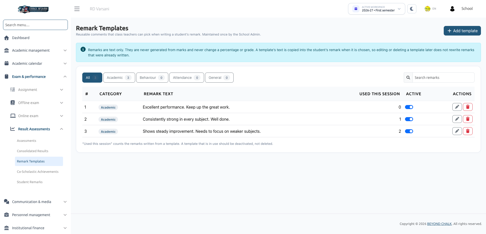

# Remark Templates

**Remark Templates** provide a centralized comment bank of pre-written teacher evaluations. School Administrators create and maintain standard feedback statements so Class Teachers can quickly populate student evaluations while maintaining consistency across report cards.

:::info Administration & Access
- **School Admin**: Full access to create, edit, deactivate, and delete remark templates.
- **Class Teacher**: Read-only access to select active templates when writing evaluations in [Student Remarks](./student-remarks.md).
:::

---

## 1. Navigating Remark Templates

Navigate to **Exam & Performance &rarr; Result Assessments &rarr; Remark Templates**.

The templates are organized into four core categories:
- **Academic**: Comments on scholastic achievement, subject mastery, work habits, and intellectual curiosity (e.g., *"Excellent academic performance. Consistently strong across all subjects"*).
- **Behaviour**: Feedback regarding classroom deportment, peer collaboration, discipline, and respectfulness (e.g., *"Exemplary classroom conduct; highly respectful to peers and staff"*).
- **Attendance**: Observations on punctuality, attendance consistency, and dedication (e.g., *"Maintains outstanding attendance and punctuality"*).
- **General**: Broad holistic observations and seasonal encouragements (e.g., *"A proactive and motivated learner with great potential"*).

---

## 2. Creating & Managing Templates

### Adding a New Template
1. Click **+ Add template**.
2. Select a **Category** (*Academic*, *Behaviour*, *Attendance*, or *General*).
3. Enter the **Remark text** (up to **255 characters**).
4. Keep the **Active — visible to class teachers** checkbox ticked.
5. Click **Save template**.

### Usage Tracking
The **Used this session** column tracks how many student evaluations currently use each template. This helps administrators identify popular remarks and clean up obsolete phrasing.

---

## 3. Important Template Behaviors

### Copy-on-Select Principle
When a class teacher selects a template for a student, the system **copies its text** directly into the student's remark record.  
- Modifying or deactivating a template later will **never alter or erase remarks already written and saved** for students.
- Teachers can personalize or edit the copied text freely on a student's record.

### Deactivation vs. Deletion
- **Deactivating In-Use Templates**: If a template has been used during the session, it should be **deactivated** rather than deleted. Deactivated templates remain preserved on existing report cards but are hidden from the teacher dropdown for future entries.
- **Deleting Templates**: Templates with zero recorded uses can be deleted safely.

---

## Next Steps
To configure non-academic evaluation areas, see [Co-Scholastic Achievements](./co-scholastic-achievements.md).
