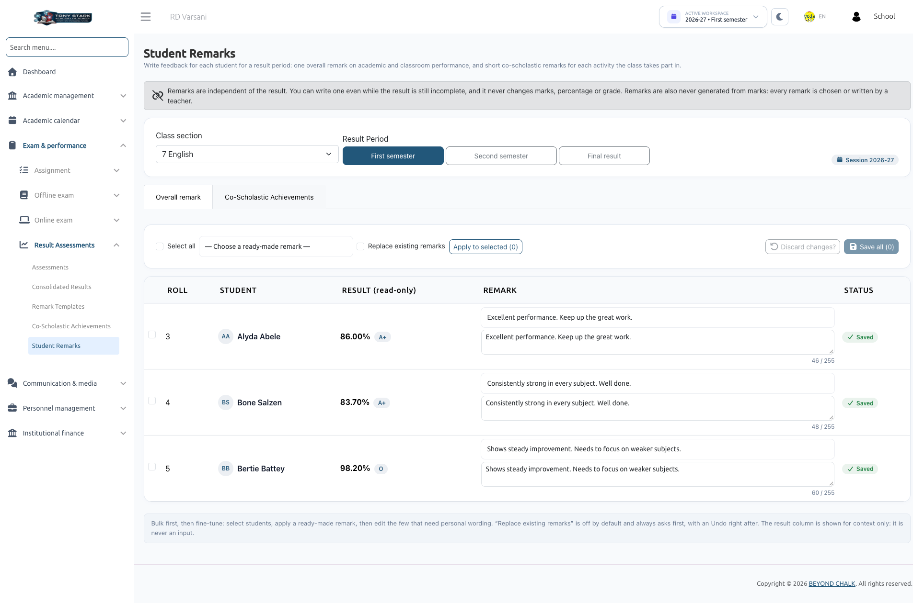
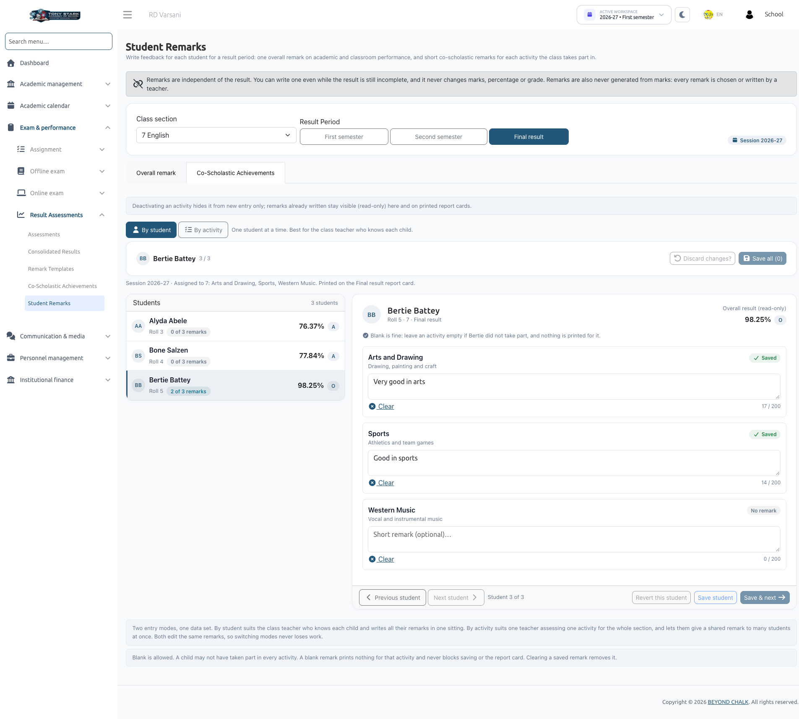

# Student Remarks

The **Student Remarks** module allows Class Teachers and School Administrators to record holistic student evaluations and extracurricular feedback. Remarks are categorized into **Overall remarks** (general evaluation) and **Co-Scholastic Achievements** remarks (performance in specific activities like Sports, Music, or Art).

:::info Role Permissions & Period Scoping
- **Class Teachers**: Can write and update remarks for students enrolled in their assigned sections.
- **Subject Teachers**: Can open section remarks in read-only mode.
- **Period Scoping**: Remarks are stored independently per **Result Period** (e.g., *First Semester*, *Second Semester*, and *Final Result* each maintain their own independent remarks).
- Remarks **never alter** calculated marks, percentages, or grades. They can be drafted even while academic results are still incomplete.
:::

---

## 1. Overall Remark Tab

Navigate to **Exam & Performance &rarr; Result Assessments &rarr; Student Remarks**.

1. Select your assigned **Class section** and the target **Result Period**.
2. For each student, enter an evaluation in the **Overall remark** field:
   - **Custom Typing**: Write custom personalized feedback (up to **255 characters**). The field tags custom text as *✎ Custom (written by me)*.
   - **Template Selection**: Click the **— Choose a ready-made remark —** dropdown to pick a pre-configured statement from [Remark Templates](./remark-templates.md). The text copies into the field and can be edited further.

### Bulk Applying Remarks
To assign identical comments to multiple students simultaneously:
1. Select students using the checkboxes (or click **Select all**).
2. Choose a template from the bulk dropdown.
3. Click **Apply to selected**.
4. If *Replace existing remarks* is enabled, confirm the replacement prompt. An **Undo** button is offered immediately if you need to revert.

### Saving Changes
Changes are held in the browser until saved:
- Rows indicate current state: **Unsaved**, **Saved**, or **Too long** (if exceeding 255 characters).
- Click **Save all** to commit evaluations.  
  *(Note: Each row saves independently. If a single student's remark exceeds character limits, valid rows save successfully while the invalid row remains highlighted for correction).*
- Click **Discard unsaved changes** to revert to the last saved state.

---

## 2. Co-Scholastic Achievements Tab

Switch to the **Co-Scholastic Achievements** tab to enter feedback for non-academic activities assigned to the class.

### Entry Modes
Choose between two efficient input modes:

1. **By Student**:
   - Focus on one student at a time.
   - View all assigned activities for that student in a vertical list.
   - Use **Save & next** or the **Previous student / Next student** navigation arrows to step through the roster.
2. **By Activity**:
   - Focus on one activity (e.g., *Sports*) for the entire section at once.
   - Ideal for specialized instructors entering observations across all students in a single table, with batch-apply tools available.

### Guidelines for Co-Scholastic Remarks
- **Character Limit**: Up to **200 characters** per activity per student.
- **Optional / Blank**: If a student did not participate in a specific activity, leave the field blank. Blank entries print nothing (or a standard dash "—" depending on report card settings).
- **Inactive Activities**: If an administrator deactivates an activity after remarks were recorded, the entries display as *"Inactive · remark kept"* in read-only mode and continue to print on report cards.
- **Missing Activities Alert**: If no activities appear, the page displays:  
  *`"No Co-scholastic Achievements are assigned to [class] for 2026-27."`*  
  Contact the School Admin to map activities in [Co-Scholastic Achievements](./co-scholastic-achievements.md).

---

## 3. Read-Only Scenarios

You may encounter read-only locks under the following circumstances:
- **Subject Teacher Assignment**: You teach a subject in the section but are not assigned as its official Class Teacher.
- **Closed Academic Sessions**: Past academic sessions are archived and locked to preserve historical record integrity.

---

## Next Steps
Once marks and remarks are entered, print official student copies in [Report Cards](../reports/report-cards.md).
