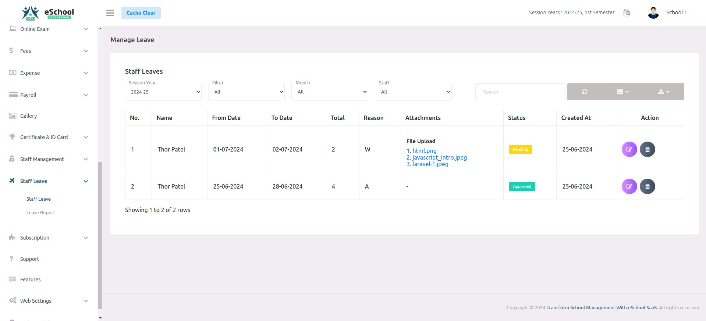
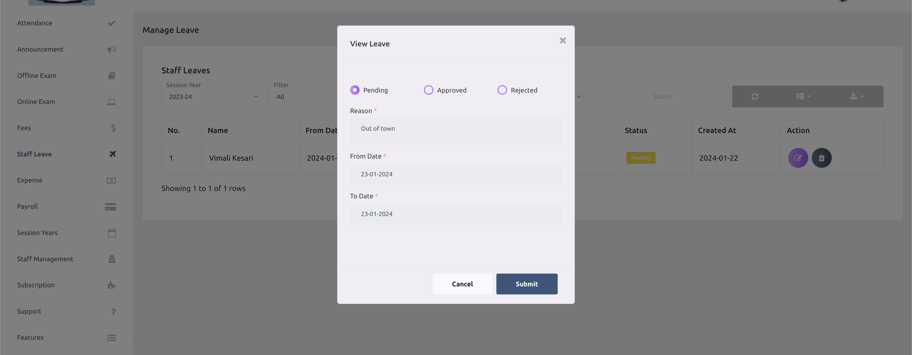

# Staff Leave Management

Staff apply for leave from the web panel or the staff app; the school admin (or anyone with the approve permission) approves or rejects it. Every approved day is paid from the staff member's **CL (Casual Leave)** balance while it lasts; whatever the balance cannot cover is **LWP (Leave Without Pay)** and is deducted from salary in Payroll.

Each staff member has a month-by-month CL **passbook** for the session year. The passbook is recalculated automatically whenever leave is applied, approved, rejected or deleted, when attendance marks someone absent, when the leave settings change, and at the start of every month.

---

## 1. Who does what

| Actor | Can |
|---|---|
| **Staff** (Teacher, Driver, Helper and any role with `leave-create`), web or staff app | Apply for leave for today or a future date, see their own requests and CL balance, delete a request while it is still Pending |
| **School Admin** (web) | See every staff leave, approve / reject / re-open, switch a day between full and half day, delete, and add leave for a staff member (approved straight away, past dates allowed) |
| **Any staff with `approve-leave`** (web / staff app) | Review and decide the leave of other staff. They never see their own requests in the review list |

---

## 2. Key terms

| Term | Meaning |
|---|---|
| **CL** (Casual Leave) | Paid leave. Comes from the yearly CL set in [Leave Settings](../system-settings/leave-settings.md) |
| **LWP** (Leave Without Pay) | Leave the CL balance does not cover. Deducted from salary: `salary ÷ 30 × LWP days` |
| **Passbook** | One line per month per staff member: brought forward, CL given, CL used, LWP, CL lapsed, balance |
| **Full / First Half / Second Half** | The type picked for each leave day. A half day counts as 0.5 |
| **Lapsed** | Unused CL that expired at month end or year end, depending on the settings |

A single day can be split. For example, with 0.5 CL left, a full day counts as 0.5 CL and 0.5 LWP.

---

## 3. Prerequisites

| # | Requirement | Where |
|---|---|---|
| 1 | **Staff Leave Management** feature active in the school's package | Super Admin → Package |
| 2 | **Leave settings saved for the current session year** | System Settings → Leave Settings. Without them, applying is refused: *"Leave setting is not configured for this session year…"* (web) / *"Kindly contact the school admin to update settings…"* (app) |
| 3 | Permissions granted to the roles that need them | Staff Management → Role & Permission |
| 4 | A **joining date** on each staff member (recommended) | Staff Management → Staff. Staff who join during the year get a prorated CL. Without a joining date, they get the full year |
| 5 | The Laravel scheduler running (cron calling `php artisan schedule:run` every minute) | Server. Needed for the monthly passbook refresh (see §9) |

### Permissions

| Permission | Guards | Default |
|---|---|---|
| `leave-list` | The staff member's own **Leave → Apply Leave** list | Teacher, Driver, Helper |
| `leave-create` | Applying for leave, and the **Leave Report** page | Teacher, Driver, Helper |
| `leave-edit` | The edit route (the screen asks staff to delete and re-apply instead) | Teacher, Driver, Helper |
| `leave-delete` | Deleting one's own pending request | Teacher, Driver, Helper |
| `approve-leave` | The **Staff Leave** review screen, approve / reject / delete, viewing another staff member's balance, and the approver APIs | School Admin |
| `leave-backdated-create` | Adding leave for past dates on behalf of a staff member | School Admin |

:::note
Adding leave **on behalf of** a staff member is tied to the **School Admin** role itself, not just to `approve-leave`. A custom role with `approve-leave` can review requests, but a leave it submits is treated as its own request.
:::

---

## 4. Leave status and source

| Status | Meaning | How the leave counts |
|---|---|---|
| `0` **Pending** | Waiting for a decision | Not counted yet. Shown as an **estimate** of the CL / LWP split |
| `1` **Approved** | Accepted | Counted in the passbook. The CL / LWP split is final |
| `2` **Rejected** | Declined | Not counted. Its split is cleared |

Every staff leave also records where it came from:

| Source | Created by |
|---|---|
| **Applied** | The staff member, from the web or the app |
| **Admin** | The School Admin, on behalf of the staff member (auto-approved) |
| **Attendance** | Staff attendance marking someone absent or half-day absent (auto-approved, see §8) |

---

## 5. Flow A: staff applies for leave

### From the web panel

**Leave → Apply Leave → Create Leave**

1. Pick the **From** and **To** dates. The form lists each date in the range, **skipping weekly off days and public holidays**.
2. For each date choose **Full**, **First Half** or **Second Half**.
3. The form shows an estimate, for example *"Estimate: 2 days CL and 1 days LWP. The final split is set when the leave is approved."*, together with **CL available now**.
4. Enter a **reason** and optionally attach files (JPG, JPEG, PNG, PDF, DOC, DOCX; size limit is the system `file_upload_size_limit` setting).
5. Submit. The request is saved as **Pending**.

### From the staff app

The app sends the chosen days with their types, a reason and optional files to `POST /api/leaves`, and can show the same estimate first using `POST /api/leave-estimate`.

### Checks

| Check | Message |
|---|---|
| A date is before today (school time zone) | "Leave can't be applied for past dates. Please contact the school admin." |
| `to_date` before `from_date` | Validation error |
| Dates outside the current session year | Validation error |
| Any existing leave of this staff member overlaps the range, **including a rejected one** | "Leave has already been applied for this period." / "You already have a leave request during this period." |
| No leave settings for the session year | See §3 |
| (App) a chosen day is a weekly off day or public holiday | "Kindly select different dates as the ones mentioned are already allocated as holidays." |
| A day falls in a month whose payroll is already paid | "Payroll for *Month Year* is already paid, so its leave can no longer change." |

After saving, every user whose **role** has `approve-leave` gets a push notification: *"\[Staff name\] has submitted a new leave request."* with the reason as the body.

### Viewing and cancelling

- **Leave → Apply Leave** lists the staff member's own requests for the session year with filters for Today / Tomorrow / Upcoming and month, the number of days, how the leave counts (CL / LWP) and the attachments.
- A staff member can **delete** a request only while it is **Pending**. Any CL it was holding is released. To change a request, delete it and apply again.

---

## 6. Flow B: reviewing a request

**Staff Leave → Staff Leave** (needs `approve-leave`)

The list shows every staff leave of the current session year, newest first, with filters for **Today / Tomorrow / Upcoming / All**, **month** and **staff**, and a search over reason, dates and staff name. For each leave it shows the staff member's role, the days, **how this leave counts** (CL / LWP; marked as an estimate while pending) and the staff member's **CL available now**.

The edit action opens the leave with its days. The approver can:

- set the **status** to Pending, Approved or Rejected;
- switch any day between **Full**, **First Half** and **Second Half** before approving.

On saving, the passbook is recalculated and the CL / LWP split of every day is fixed. The staff member then receives:

| Decision | Push notification | WhatsApp (Communication Center) |
|---|---|---|
| Approved | "Your Leave Request Has Been Approved! Counted as *x* CL and *y* LWP." | `leave_approved` template, with from / to date and school name |
| Rejected | "Your Leave Request Has Been Rejected!" | `leave_rejected` template |

The same actions are available in the staff app through `GET /api/staff/leave-request` and `POST /api/staff/leave-approve`.

### Deleting

An approver can delete any staff leave (web delete action, or `POST /api/staff/leave-delete`). Its attachments are removed and the CL it used is given back. Deletion is refused if the leave falls in a month whose payroll is already paid.

---

## 7. Flow C: admin adds leave for a staff member

**Staff Leave → Staff Leave → Create Leave**, as **School Admin**.

1. **Select staff**, pick the dates, the day types and a reason.
2. The form shows *"This leave will count as x days CL and y days LWP."*
3. Submit. The leave is created **already Approved**, with the admin recorded as the one who added it.

Differences from a staff request:

- **Past dates are allowed** with the `leave-backdated-create` permission, for recording leave that was missed. Without it: *"You don't have permission to add leave for past dates."*
- If the dates overlap **absences created automatically by attendance**, those automatic records are removed and the admin's leave takes their place. An overlap with any other leave is still refused.
- The staff member is notified: *"Leave Request Approved: Your leave request has been created and approved by \[admin\]."* For past dates the notification is *"Leave added for past dates: \[admin\] added leave for you from … to …"*. Both include how the leave was counted.

---

## 8. How CL and LWP are worked out

The rules come from [Leave Settings](../system-settings/leave-settings.md). In short:

1. **Credit.** Each staff member is entitled to the **Yearly CL**. With *Every month*, it is spread evenly over the months of the session year. With *All at the start of the year*, it is all given in the first month.
2. **Joining during the year.** The yearly CL is prorated by the days left in the session year from the joining date. Months before the joining month get nothing.
3. **Using CL.** Approved leave days are paid in **date order**: earlier days use CL first. A day is paid up to the balance (and up to the **Maximum CL in one month**, if set); the rest of it is LWP.
4. **Expiry.** If *Unused monthly CL expires* is on, CL left at the end of a month lapses. Otherwise it adds up. At the end of the session year, the balance either **carries forward** to the next session year or lapses.
5. **Ended months keep their rules.** A settings change applies from the current month on; months that have ended keep the credit they were given. Their CL / LWP split can still change, for example after a backdated leave.

**Example.** Yearly CL 12, given every month, unused CL expires. Each month gives 1 CL. A staff member takes 3 full days in one month: 1 day is CL and 2 days are LWP.

### CL available now

**CL available now** is what the staff member can use today without turning approved leave in later months into LWP:

- when monthly CL expires, it is this month's balance;
- otherwise, it is the lowest balance from this month to the end of the session year.

### Absences from staff attendance

When staff attendance is saved, it keeps an approved **Attendance** leave in step with the register:

| Attendance mark | Leave record |
|---|---|
| Absent | Full day |
| First half present | Second half |
| Second half present | First half |
| Present | Any attendance-created leave for that day is removed |

Leave entered by the admin for that day takes priority: attendance only adds the part the admin's leave does not already cover. Whether these absences can use CL depends on the **When attendance marks staff absent** setting (*Use CL if available, rest LWP* or *Always LWP*). The rule in force on the day the absence is recorded stays with it.

Attendance for a staff member whose payroll for that month is already paid is skipped.

### Public holidays added later

Adding a public holiday removes that date from approved leaves that cover it. If a leave has no days left, it is deleted and the staff member is notified that it was rejected because the range includes a holiday. A holiday cannot be added on a date that already has staff attendance.

---

## 9. Payroll and paid months

- When salary is paid in **Payroll**, the month's **paid leaves** are taken from the passbook (CL used that month) and the deduction is `salary ÷ 30 × LWP`.
- Paying a month **locks** it for that staff member. Any change that would alter a locked month, through its leave days or the balance it opened with, is refused with *"Payroll for Month Year is already paid, so its leave can no longer change."* This applies to applying, approving, rejecting, deleting and attendance.
- Deleting the payroll payment unlocks the month again.

### Monthly refresh

The scheduled command `staff-leave:refresh-balances` runs at 01:30 on the 1st and 2nd of every month. It closes the month that just ended (showing any lapsed CL) and opens the new month's line with its credit. It is safe to run twice. Opening the **Leave Report** also brings that staff member's passbook up to date.

---

## 10. API reference

All endpoints need `Authorization: Bearer {token}` and the school header used by the staff app, and sit behind the **Staff Leave Management** feature check.

### Staff (own leave)

| Method | Endpoint | Body / query |
|---|---|---|
| GET | `/api/leave-settings` | `session_year_id` optional. Settings (`staff_leave` block with the CL rules) and public holidays |
| POST | `/api/leave-estimate` | `leave_details[i][date]` (Y-m-d), `leave_details[i][type]` (`Full`, `First Half`, `Second Half`). Returns the CL / LWP split per day and `available_now` |
| POST | `/api/leaves` | `reason`, `leave_details[i][date]`, `leave_details[i][type]`, `files[]` optional (multipart) |
| GET | `/api/my-leaves` | `session_year_id`, `month` (1–12), `status` (0/1/2), all optional. Each leave has `counted_as`; plus `summary`, `balance` and `month_balance` |
| POST | `/api/delete-my-leaves` | `leave_id`. Pending only |
| GET | `/api/leave-balance` | `staff_id` (needs `approve-leave` for someone else), `session_year_id` optional. Rules, plain-word explanation, summary and month-by-month passbook |
| GET | `/api/leaves` | `type`: 0 today, 1 tomorrow, 2 upcoming. Approved staff leave days, for the "who is on leave" list |
| GET | `/api/staff-leaves-details` | `staff_id` required (needs `approve-leave` for someone else), `session_year_id`, `month`, `status` optional |

### Approver (`approve-leave`)

| Method | Endpoint | Body / query |
|---|---|---|
| GET | `/api/staff/leave-request` | `leave_id` optional. Without it, all **pending** requests, each with `counted_as` and `cl_available` |
| POST | `/api/staff/leave-approve` | `leave_id`, `status` (`1` approve, `2` reject, `0` back to pending) |
| POST | `/api/staff/leave-delete` | `leave_id` |

### Web routes

| Method | Route | Name |
|---|---|---|
| GET | `leave` | `leave.index` (Apply Leave) |
| POST | `leave` | `leave.store` |
| DELETE | `leave/{id}` | `leave.destroy` |
| POST | `leave/estimate` | `leave.estimate` |
| GET | `leave/request` | `leave.request` (Staff Leave review) |
| GET | `leave/request/show` | `leave.request.show` |
| PUT | `leave/status/update` | `leave.status.update` |
| GET | `leave/report` | `leave.report` (Leave Report) |
| resource | `leave-master` | Leave Settings |

---

## 11. Data model

| Table | Role |
|---|---|
| `leaves` | The request: `user_id`, `reason`, `from_date`, `to_date`, `status`, `source` (1 applied, 2 admin, 3 attendance), `always_lwp`, `added_by`, `leave_master_id` |
| `leave_details` | One row per leave day: `date`, `type` (`Full` / `First Half` / `Second Half`), `cl_part`, `lwp_part` |
| `leave_masters` | One row per session year: `yearly_leaves`, `credit_mode` (`monthly` / `upfront`), `monthly_expiry`, `monthly_max`, `carry_forward`, `absence_rule` (`cl_first` / `always_lwp`), `holiday` (weekly off days). `leaves` (per month) is kept for older app versions |
| `staff_leave_balances` | The passbook: one row per staff member per month with `opening`, `credited`, `cl_used`, `lwp`, `expired`, `closing`, `monthly_max`, `expires`, `is_locked` |
| `files` (morph) | Attachments on a leave |
| `staff_attendances` | Links an absence to its attendance-created leave |
| `expenses` | Payroll payment; `paid_leaves` is the CL used that month |

The same `leaves` table also stores **student** leave ([Student Leave Management](../attendance/student-leave.md)). The passbook only ever touches users who have a staff record.

### Upgrading from older versions

Version 1.13.0 moves existing schools to the CL passbook without changing past results. Old *Total Leaves Per Month* settings become: Yearly CL = per month × months, given every month, unused CL expires, no monthly maximum, no carry forward, absences use CL first. If the old per-month value was under 1, CL is given all at the start of the year instead. Months whose payroll was already paid are locked with the paid figures. The step runs during the update; it can be re-run safely with `php artisan staff-leave:migrate-existing`.

---

## 12. Troubleshooting

| Symptom | Cause / fix |
|---|---|
| "Leave setting is not configured for this session year…" | Save [Leave Settings](../system-settings/leave-settings.md) for the active session year |
| Menu item missing | The user lacks the permission (see §3), or the package lacks **Staff Leave Management** |
| "Leave has already been applied for this period." | Another leave overlaps the dates, **including a rejected one**. Delete the old leave first (an approver can delete any leave; staff can only delete pending ones) |
| Staff cannot pick a past date | Expected. Staff can only apply from today. The School Admin can add it with *Create Leave* (needs `leave-backdated-create`) |
| "Payroll for … is already paid, so its leave can no longer change." | That month is locked. Delete the payroll payment for the month first if the leave really must change |
| Leave counted as LWP although CL seemed available | CL is used in date order, so earlier approved leave (also in later months, when CL does not expire monthly) may already use it. Also check **Maximum CL in one month** and the absence rule for attendance-created absences |
| A pending leave shows different numbers after approval | Pending figures are an estimate against today's balance; the final split is set on approval |
| Ended month did not show lapsed CL | The monthly refresh has not run. Check the cron for `schedule:run`, or open the staff member's Leave Report, which recalculates it |
| Settings saved with "Leave balances of N staff could not be updated" | Some passbooks could not be recalculated, usually because of a payroll-locked month. Check the application log for the staff IDs |
| Approver did not get a push for a new request | The push goes to users whose **role** has `approve-leave`; a permission granted directly to a user is not included |
