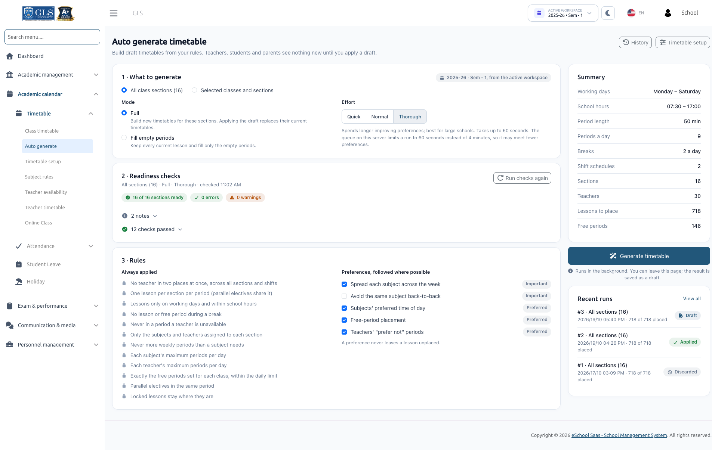
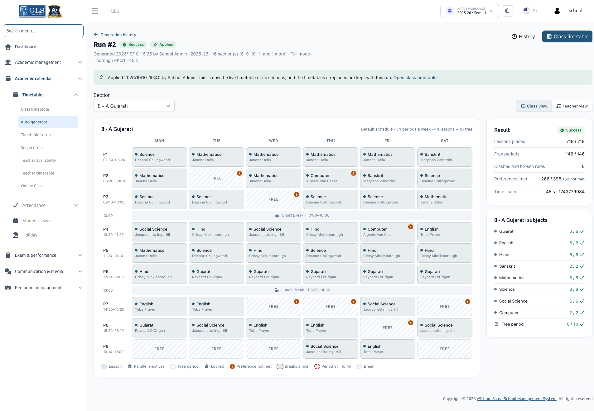
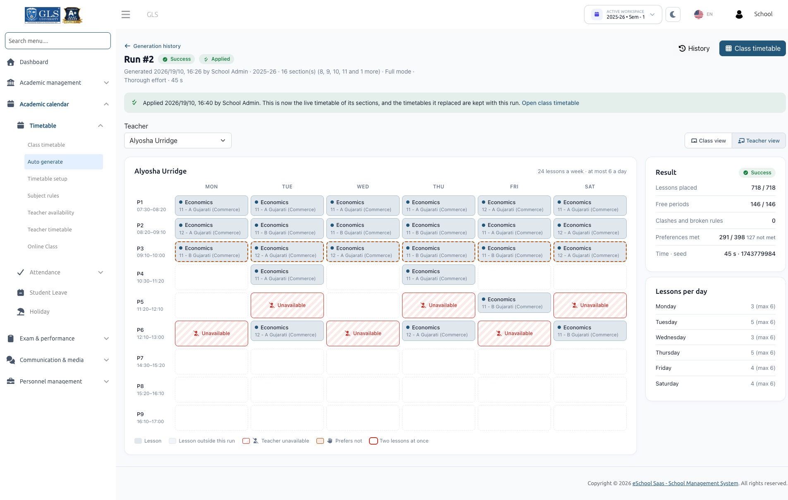
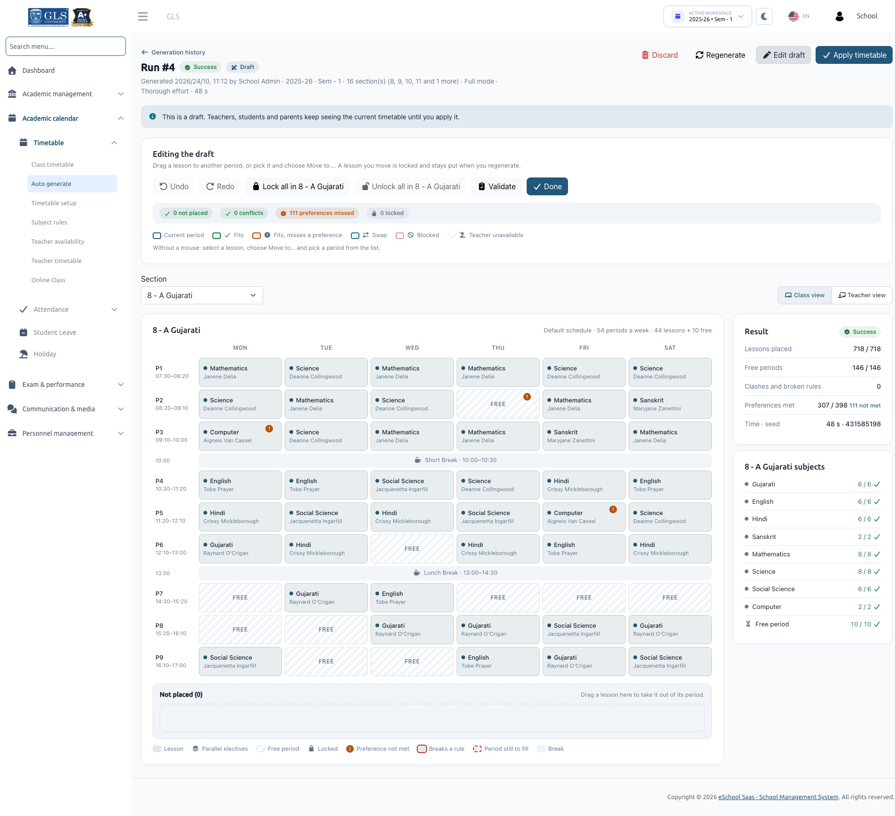

# Auto Generate Class Timetable

The **Auto Timetable Generator** automatically computes balanced, conflict-free weekly schedules for your school's classes and sections. It takes into account school hours, working days, break timings, subject weekly quotas, teacher assignments, maximum daily lesson limits, parallel electives, and teacher availability constraints.

The generator produces a **Draft** timetable. Generating a draft changes nothing for teachers, students, or parents until a school administrator explicitly reviews, adjusts, and applies it.

---

## 1. What the Feature Does

### What it Does
- Generates complete weekly schedules automatically adhering to both institutional hard constraints and pedagogical soft preferences.
- Balances teacher workloads so that no teacher is double-booked across sections or shifts.
- Creates non-destructive drafts that can be reviewed, edited by hand, re-tested, locked, and regenerated prior to going live.
- Manages smooth promotion to the live timetable, migrating existing online class links and retaining historical records.

---

## 2. Permissions, Requirements & Concurrency

### Required Permissions
| Action | Required Permission |
| :--- | :--- |
| Open **Auto generate**, configure **Subject rules**, set **Teacher availability**, review drafts, regenerate, discard, apply, and view **Generation history** | `timetable-generate` |
| Configure **Timetable setup** and edit live timetables in **Class timetable** | `timetable-create` |
| View **Teacher timetable** and manage **Online Class** links | `timetable-list` |

:::note System Administrators & Custom Roles
The standard **School Admin** role comes pre-configured with all of these permissions. For custom roles, assign these permissions under *Staff Management &rarr; Role & Permission*.
:::

### Additional Prerequisites
- **Package Feature**: Your school's subscription package must include both **Timetable Management** and **Auto Timetable Generator**.
- **Active Workspace**: Generation is tied to the active **Session Year and Semester** selected in the top navigation header. Drafts belong strictly to the workspace in which they were created.
- **Single Run Concurrency**: Only one generation run can execute within a school at any given time. If another administrator has an active run, the page displays:  
  *`"Run #7, started by Priya Shah at 10:15, is still running. Wait for it to finish or stop it."`*

---

## 3. Preparation Checklist Before You Start

Before launching generation, complete the following setup steps:
1. **Classes & Sections**: Ensure all classes and sections are created for the active session year.
2. **Class Subjects Assigned**: Subjects must be linked to each class for the active semester.
3. **Teacher Assignments**: Every subject must have an assigned teacher in every section.
4. **[Timetable Setup](./timetable-setup.md)**: School start/end hours, period length, working days, and breaks must be saved.
5. **[Subject Rules](./subject-rules.md)**: Weekly periods and daily limits must be saved. Lessons + free periods must add up to exactly the total slots in a week.
6. **[Teacher Availability](./teacher-availability.md)**: (Optional) Mark unavailable times and daily limits for teachers with scheduling constraints.
7. **Staff Shifts**: (Optional) Assign shifts to teachers if your school operates multiple shifts (e.g., Morning and Afternoon).

---

## 4. Starting a Generation Run

Open **Academic calendar &rarr; Timetable &rarr; Auto generate**. The configuration workflow consists of three panels:

### Panel 1 · What to Generate

#### 1. Scope
- **All class sections**: Generates the schedule across all sections in the school simultaneously.
- **Selected classes and sections**: Allows choosing specific classes or individual section badges (e.g., *8-A, 8-B, 9-A*).
  - *Outside Section Detection*: If teachers in your selection also teach classes outside this run, the system alerts you:  
    *`"Teachers in this run also teach 2 other sections (9-A, 9-B). Their current timetables stay fixed, so those teachers are placed only where they are free."`*  
    Click **Add these 2 sections** to include them in the run if their periods should be flexible.

#### 2. Mode
- **Full**: Builds a completely fresh timetable for the selected sections. Applying the draft overwrites their existing schedules.
- **Fill empty periods**: Preserves all lessons already present in the live timetable and places new lessons only into unassigned periods.

#### 3. Effort Level
- **Quick**: Produces a rapid initial draft in a few seconds.
- **Normal**: Optimal balance between fast computation and satisfying preferences.
- **Thorough**: Spends extended computation time exploring permutations to satisfy maximum soft preferences; ideal for large schools with complex teacher constraints.

:::info Queue Worker vs Browser Execution
If your server has a background queue worker running, generation runs asynchronously in the background, allowing you to navigate away. If no queue worker is active, generation runs in 15-second iterative browser steps while the page remains open.
:::

---

### Panel 2 · Readiness Checks

The system immediately validates all rules as soon as you choose scope and mode:

- **Errors**: Block generation. All errors must be resolved before proceeding (e.g., missing teachers, slot count mismatch).
- **Warnings**: Non-blocking notices highlighting constraints that may limit scheduling (e.g., shift restrictions, heavy teacher load).
- **Notes**: Informational messages (e.g., subjects with 0 weekly periods left for manual assignment).

Click **Run checks again** after making modifications in other tabs.

---

### Panel 3 · Rules & Preferences

The generator enforces two tiers of rules:

1. **Always Applied (Hard Constraints)**: Inviolable rules that are never relaxed (e.g., no teacher double-booking, break protection, shift boundaries).
2. **Preferences (Soft Constraints)**: Can be toggled on or off to guide the optimization engine:
   - **Spread each subject across the week** (Important)
   - **Avoid the same subject back-to-back** (Important)
   - **Subjects' preferred time of day** (Preferred)
   - **Free-period placement** (Preferred)
   - **Teachers' "prefer not" periods** (Preferred)

:::tip Guiding Principle
A preference will **never** cause a lesson to remain unplaced. The engine will satisfy preferences whenever possible, but will prioritize placing every lesson over adhering to a soft preference.
:::

Click **Generate timetable** to start the engine.

---

## 5. Reviewing and Adjusting the Draft

Once computation finishes, the generated draft opens automatically.

### Section View

The Section View shows the weekly timetable for each class section. Use the section tabs or dropdown to switch between classes. Each cell displays the subject, assigned teacher, and period timing. Breaks and free periods are clearly highlighted.

---

### Teacher View

Switch to **Teacher view** to inspect any teacher's weekly workload across all classes. Lessons taught by this teacher in classes outside the current run are labeled as **Other lesson** and kept fixed.

---

### Result & Status Badges
At the top of the draft page, two badges communicate the state of the run:

- **Result Badge**:
  - **Success**: Every required lesson and free period was successfully placed.
  - **Partial**: Some lessons could not be placed due to tight constraints.
  - **Cancelled**: The generation was stopped early by an administrator.
- **Status Badge**:
  - **Draft**: Open for review, manual editing, or regeneration.
  - **Stale**: Academic data (teachers, subjects, hours) or live timetables changed after generation.
  - **Applied**: Promoted to live school timetables.
  - **Discarded**: Dismissed by an administrator.

---

### Handling Partial Results
If any lessons could not be scheduled, an alert banner explains the situation (e.g., *"526 of 528 lessons placed. 2 periods in 8-A could not be placed"*):
- **Why Lessons Were Not Placed Table**: Displays the section, subject, teacher, required vs placed periods, and the exact bottleneck reason (e.g., teacher unavailable, daily limit reached).
- **Suggested Fixes**: Direct action links to resolve bottlenecks (e.g., *"Raise max per day of Maths"*, *"Review availability of Asha Nair"*).
- **Unplaced Lessons Tray**: Displays unplaced cards ready to be manually dropped into the grid.

---

### Interactive Hand Editing

Click **Edit draft** to open interactive manual adjustment tools:

| Action | How to Perform |
| :--- | :--- |
| **Move a lesson** | Drag and drop the lesson card into any period, or select it and use **Move to...**. Moving a lesson automatically **locks** it. |
| **Send to tray** | Drag a lesson to the bottom tray or click **Send to tray**. |
| **Place from tray** | Drag any card from the tray directly onto a valid period slot. |
| **Swap lessons** | Drag one lesson over another period showing the **Swap** indicator to switch their positions. |
| **Lock / Unlock** | Click the padlock icon on a card, or use **Lock all in [Section]** / **Unlock all in [Section]**. Locked lessons remain frozen during regeneration. |
| **Undo / Redo** | Use the **Undo** and **Redo** toolbar buttons to step back through manual changes. |
| **Validate** | Click **Validate** to recalculate the draft against current school data, checking for any conflicts or rule violations. |

#### Drag & Drop Color Legend
When dragging a lesson card, target periods indicate availability:
- **Current period**: Current location of the lesson.
- **Fits**: Fully valid, rule-compliant slot.
- **Fits, misses a preference**: Valid slot that misses a soft preference (e.g., afternoon preference placed in morning).
- **Swap**: Valid to swap with the existing lesson in that slot.
- **Blocked**: Cannot be placed (hover to view reason, e.g., section conflict, max daily limit reached).
- **Teacher unavailable**: Teacher is marked unavailable or outside their shift during this period.

---

### Stale Drafts, Regenerating & Discarding

- **Stale Drafts**: If timetable hours, subject rules, teacher shifts, or other drafts are modified after a draft was generated, it is flagged as **Stale**. Click **Validate** to test it against latest data, or **Regenerate** to update it.
- **Regenerate**: Starts a new run using the same parameters. Lessons you have **locked** remain frozen in their assigned positions, while unlocked lessons are rearranged with a new random seed.
- **Discard**: Click **Discard** to dismiss the draft. Current live school timetables remain completely untouched.

---

## 6. Applying the Timetable

When satisfied with the draft, click **Apply timetable**.

### The Apply Modal
The modal conducts a final pre-flight verification:
1. **Fix this before you apply**: Displays any blocking errors (e.g., newly introduced teacher clashes).
2. **What changes**: Outlines the exact database updates for each section:
   - **Replace**: Overwriting an existing timetable.
   - **Create**: Creating a new timetable for a section that had none.
   - **Fill empty periods**: Adding lectures to vacant slots without touching existing rows.
   - Displays counts of lesson rows, free periods, and break rows written.
3. **Online Class Links**:
   - Links where the teacher and subject remain at the same time are preserved.
   - Links where the lesson shifted to another time on the same day are moved automatically.
   - Unmatchable links are flagged for removal with clear instructions.

### Confirmation & Going Live
To prevent accidental overwrites, administrators must tick the required confirmation checkbox:
- *"I understand the current timetables of [X] class sections will be replaced."*
- If applying a partial draft: *"Apply without the [X] periods that are not placed."*

Click **Apply timetable**. The draft immediately becomes the live timetable for teachers, students, and parents.

:::caution Full Mode Overwrite
Applying in **Full mode** replaces the entire live schedule of the selected sections, including any lessons previously scheduled by hand. While replaced historical entries are stored in the audit log, they cannot be automatically restored from the interface.
:::

---

## 7. After You Apply

Once applied:
- **Instant Synchronization**: Students, teachers, and parents immediately see the updated schedule across the web portal and mobile apps.
- **Class Timetable Source Indicators**: On the main **Class timetable** list, each section displays its origin:
  - **Auto · run #12**: Generated by auto-timetable run #12 and unaltered.
  - **Auto · edited**: Generated by auto-timetable, then manually adjusted.
  - **Manual**: Built entirely by hand.
  - **No timetable**: Sections without any schedule.
- **Editing Live Timetables by Hand**: Clicking the edit button on any section opens the manual editor. For auto-generated schedules, the editor displays *"Auto-generated (run #12)"*, continues enforcing real-time conflict prevention, and displays live period counters (*"Placed / needed"*).

---

## 8. What the Generator Always Follows

The constraint engine guarantees that the following **12 Inviolable Rules** are never compromised:

1. **No Double-Booking**: No teacher is scheduled in two places at the same time across all sections and shifts.
2. **Single Section Occupancy**: Each class section has at most one lesson per period (parallel electives share the same period).
3. **Working Days & Hours**: Lessons are placed strictly on designated working days and within school hours.
4. **Break Integrity**: Neither lessons nor free periods are ever placed during scheduled breaks.
5. **Teacher Availability**: Lessons are never scheduled when a teacher is marked unavailable or outside their shift.
6. **Valid Assignments**: Only subjects and teachers explicitly assigned to a class section are scheduled.
7. **Exact Weekly Quota**: A subject never receives more weekly periods than specified in Subject Rules.
8. **Subject Daily Limits**: A subject never exceeds its configured **Max / day** limit.
9. **Teacher Daily Limits**: A teacher never exceeds their configured **Max periods per day**.
10. **Free Period Compliance**: Exactly the configured number of free periods are placed, adhering to daily free period caps.
11. **Parallel Electives**: Subjects belonging to the same parallel elective group are always scheduled in the exact same period slot.
12. **Locked Lessons**: Any lessons locked during draft editing remain firmly anchored to their assigned period.

---

## 9. Messages & Troubleshooting Reference

### Readiness Check Messages
| Message | Severity | Resolution |
| :--- | :--- | :--- |
| `"No working days are set."` | **Error** | Select active working days in [Timetable Setup](./timetable-setup.md). |
| `"The day must end after it starts (14:00 – 08:00)."` | **Error** | Correct start and end hours in Timetable Setup. |
| `"Break 'Lunch' is outside school hours."` | **Error** | Adjust break start/end times to fall within school hours. |
| `"Default schedule has 66 periods a week; the generator supports at most 63."` | **Error** | Reduce working days or increase period length so total weekly slots do not exceed 63. |
| `"8-A has no subjects for this session year."` | **Error** | Map subjects to the class in Academic Management. |
| `"8-A: no subject has weekly periods set."` | **Error** | Set **Periods / week** in [Subject Rules](./subject-rules.md). |
| `"8-A needs 44 periods (38 lessons + 6 free), but the week has 42."` | **Error** | Adjust lessons or free periods to match exactly 42 weekly slots. |
| `"Maths in 8-A has 7 weekly periods but no teacher."` | **Error** | Assign a teacher to Maths in the class section settings. |
| `"Maths in 8-A: the teacher split adds up to 6, but the subject has 7."` | **Error** | Fix teacher split numbers in Subject Rules so the sum equals 7. |
| `"Parallel electives Music/Art in 8-A need the same weekly periods."` | **Error** | Ensure all electives in a parallel group have identical weekly period counts. |
| `"Asha Nair teaches two subjects of parallel electives Music/Art."` | **Error** | Assign distinct teachers to parallel elective subjects. |
| `"Asha Nair has 40 periods to teach but only 36 available periods."` | **Error** | Expand teacher availability or reassign some sections to another teacher. |
| `"Asha Nair can teach at most 5 periods a day (25 a week) but has 30."` | **Error** | Increase teacher's daily limit or reassign classes. |

### Partial Result Reasons (Why a Lesson Was Not Placed)
| Reason in Report | Recommended Action |
| :--- | :--- |
| `"Asha Nair is teaching elsewhere in every open period of 8-A."` | Free a conflicting period or include the other sections in the same generation run. |
| `"Asha Nair is unavailable in 6 of 8-A's 8 open periods."` | Review and relax teacher unavailability markers in Teacher Availability. |
| `"Maths already has 1 period(s) on every day that still has an open period."` | Increase **Max / day** for Maths in Subject Rules. |
| `"Asha Nair already has 5 periods on those days."` | Increase the teacher's **Max periods per day** limit. |
| `"8-A has no open period left; others hold locked lessons or free periods."` | Unlock lessons or reduce free period allocation. |

---

## 10. Technical Limits

- **Maximum Weekly Slots**: The system supports up to **63 slots per week** (e.g., 6 working days × 10 periods/day = 60 slots).
- **Subject Quotas**: Up to **20 periods per week** and **4 periods per day** per subject.
- **Exact Fit Requirement**: For every section, the sum of subject lessons and free periods must equal the weekly slots exactly.
- **Draft Retention**: The system retains detailed, interactive lesson grids for the **20 newest drafts and applied runs** per school/session.

---

## 11. Worked Example: Generating Class 8-A

Here is an end-to-end example demonstrating how to configure and generate a complete timetable for Class 8-A:

### 1. Timetable Setup
- **Working Days**: Monday through Saturday (6 days).
- **School Hours**: 08:00 to 13:00.
- **Period Length**: 40 minutes.
- **Break**: Add *Lunch break* from `10:40` to `11:00`.
- **Resulting Schedule**: 7 periods per day = **42 slots per week**.

### 2. Subject Rules
Map weekly quotas for Class 8:
- English: 6 periods/week (Max 1/day)
- Hindi: 5 periods/week (Max 1/day)
- Mathematics: 7 periods/week (Max 2/day)
- Science: 6 periods/week (Max 1/day)
- Social Science: 5 periods/week (Max 1/day)
- Computer: 3 periods/week (Max 1/day)
- Art: 2 periods/week (Max 1/day)
- Physical Education: 2 periods/week (Max 1/day)
- **Total Lessons**: 36 lessons.
- **Free Periods**: Set **Free periods per week** to **6** (36 + 6 = 42 slots). Set **Max free periods a day** to 1.
- Save Subject Rules.

### 3. Teacher Availability
- Mathematics teacher Rahul Mehta works the Afternoon shift (`10:30 – 17:00`), meaning Periods 1 to 4 (`08:00 – 10:40`) are outside his shift.
- Rahul is also marked Unavailable on Saturday.
- The system confirms Rahul has 15 available slots (Periods 5–7, Mon–Fri), which comfortably accommodates his 7 Mathematics periods.

### 4. Generation & Review
- In **Auto generate**, choose Class 8-A, select **Full mode**, and choose **Normal effort**.
- Readiness checks pass with zero errors.
- Click **Generate timetable**.
- In the draft, all 36 lessons and 6 free periods are successfully scheduled.
- In Section View, drag one Mathematics period on Monday to Wednesday to optimize lesson spread; the moved lesson automatically locks.

### 5. Apply
- Click **Apply timetable**.
- Review the summary showing 36 lessons, 6 free periods, and 6 break rows to be written.
- Check the confirmation box and click **Apply timetable**.
- Class 8-A is now live and labeled as **Auto · run #1** on the Class Timetable dashboard.
