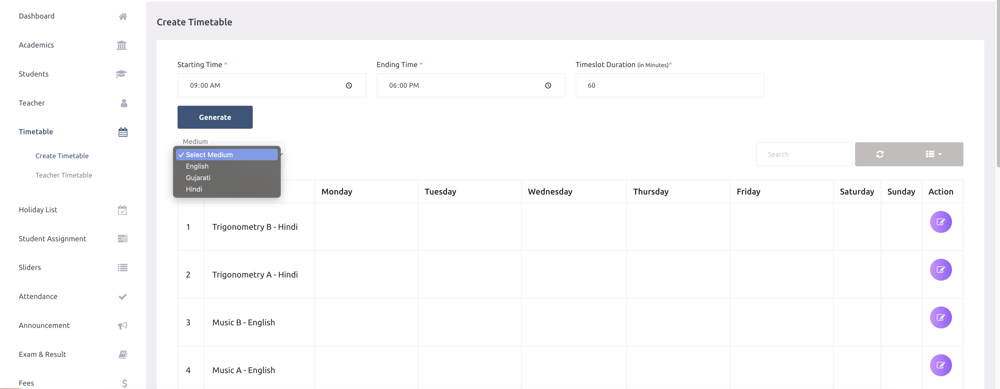
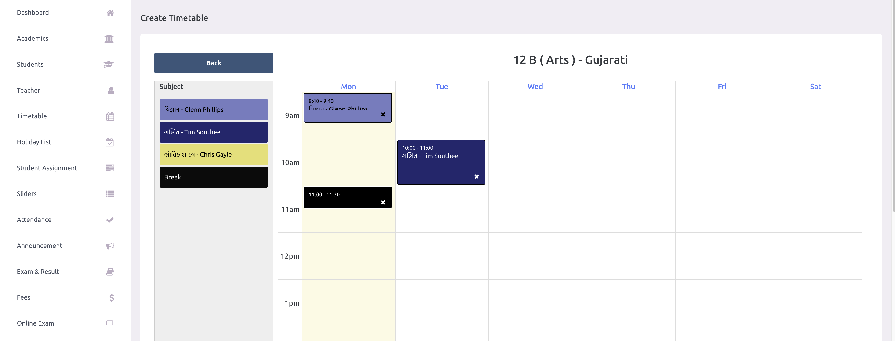

# Class Timetable

The **Class Timetable** module (located under **Academic calendar &rarr; Timetable &rarr; Class timetable**) is the central management dashboard for all class schedules across your school. From here, school administrators can review scheduled class sections, build timetables manually, launch the automated timetable generator, and edit existing schedules.

---

## 1. Dashboard Overview & Action Buttons

The top header of the Class Timetable page provides quick shortcuts for timetable configuration:
- **Timetable setup**: Direct shortcut to configure school hours, working days, period length, and breaks. See [Timetable Setup](./timetable-setup.md).
- **Auto generate**: Opens the automated constraint satisfaction engine to generate optimized drafts. See [Auto Generate Timetable](./auto-generate.md).
- **Draft Notification Banner**: If a draft has been generated and is awaiting administrator review, a notification appears at the top (e.g., *"Draft run #12 is waiting for review (8 sections, 320 of 324 lessons placed)"*) with a direct **Review draft** button.

---

## 2. Timetable Sources & Status Indicators

The main table lists every class section along with its status and creation origin under the **Source** column:

| Source Indicator | Meaning & Workflow |
| :--- | :--- |
| **Auto · run #[ID]** | The schedule was generated automatically by the specified run (e.g., *Run #12*) and has not been altered since being applied. |
| **Auto · edited** | The schedule originated from an auto-generated draft, but one or more lessons were subsequently adjusted by hand in the manual editor. |
| **Manual** | The schedule was composed entirely by hand in the manual timetable editor. |
| **No timetable** | The section does not yet have a schedule. Quick action links allow you to **Build it by hand** or click **Generate** to open the auto generator with that section pre-selected. |

---

## 3. Creating & Editing Timetables by Hand

Click the **Edit** action button next to any section to open the manual timetable grid.

### Live Rule Validation & Period Counters
When modifying a timetable manually:
- **Conflict Prevention**: The editor actively verifies teacher availability, shift constraints, and breaks on every change. If an edit creates a conflict, the system displays an explicit alert (e.g., *"Asha Nair is already teaching 8-B at this time (09:00 – 09:40)"*).
- **Subject Counters**: Live counters display the balance of placed versus required periods for each subject (e.g., *"Placed / needed: 5 of 6 periods placed this week"*).
- **Shift Restrictions**: Teachers assigned to shifts cannot be scheduled into periods that start or conclude outside their shift hours.
- **Working Day Changes**: If working days in Timetable Setup are modified after timetables are live, the editor highlights orphaned lessons (e.g., *"Lessons are still scheduled on Saturday, which is not a working day. Move or delete them, or change working days in Timetable setup"*).

---

## Related Guides
- [Auto Generate Timetable](./auto-generate.md): Build balanced schedules automatically.
- [Timetable Setup](./timetable-setup.md): Define school hours, shifts, working days, and breaks.
- [Subject Rules](./subject-rules.md): Configure weekly lesson quotas and limits.
- [Teacher Availability](./teacher-availability.md): Mark teacher working hours and shift boundaries.
- [Generation History](./generation-history.md): Review past generation runs and audit logs.
- [Teacher Timetable](./teacher-timetable.md): View timetables organized by teacher.
- [Online Classes](./online-classes.md): Attach virtual meeting links to timetable periods.