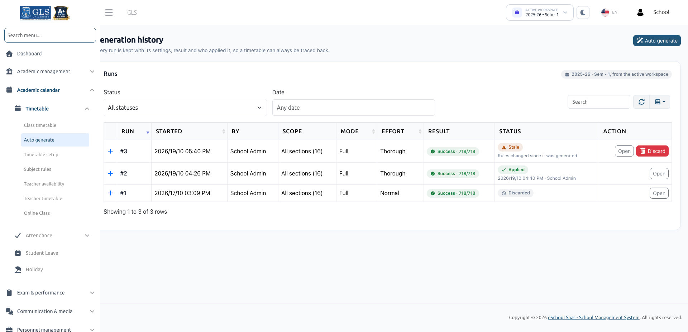

# Generation History

The Generation History module provides an audit trail of every timetable generation run conducted within your school. It logs who generated the draft, who applied it, the configuration parameters, optimization scores, and links to review or inspect drafts.

:::info Accessing Generation History
Navigate to **Academic calendar &rarr; Timetable &rarr; Auto generate** and click the **History** button in the top right corner, or click **View all** under the **Recent runs** panel. You can also access it directly from the Timetable sidebar menu.
:::

---

## 1. Runs Table & Overview

The **Runs** table lists every timetable generation attempt in reverse chronological order:

| Column | Description |
| :--- | :--- |
| **Run** | Unique incremental identifier (e.g., *Run #12*). |
| **Started** | Timestamp when the generation was initiated. |
| **By** | Administrator or staff member who launched the run. |
| **Scope** | Scope of sections included (e.g., *All 24 sections*, *Class 8 (3 sections)*). |
| **Mode** | Generation mode: **Full mode** or **Fill-empty mode**. |
| **Effort** | Effort level used: **Quick**, **Normal**, or **Thorough**. |
| **Result** | Outcome badge: **Success**, **Partial**, or **Cancelled**. |
| **Status** | Lifecycle state badge: **Draft**, **Stale**, **Applied**, or **Discarded**. |
| **Action** | Action buttons to open the draft, view details, or inspect historical entries. |

---

## 2. Filtering & Search Tools

Above the runs table, several tools allow administrators to locate specific generation runs:

- **Filter by Status**:
  - **All statuses**: Displays every run on record.
  - **Draft**: Open, pending drafts waiting for administrator review.
  - **Stale**: Drafts whose underlying data (subjects, teachers, hours, or newer applied timetables) changed after generation.
  - **Applied**: The run currently promoted to live class timetables.
  - **Discarded**: Drafts dismissed by administrators or archived by the system.
  - **Running or queued**: Generations currently in progress or awaiting worker processing.
  - **Failed**: Runs terminated prematurely due to server or connection errors.
- **Filter by Date**: Narrow down runs generated during a specific date range.
- **Search Bar**: Quickly find runs by typing the run number (e.g., `#12`) or the generator's name.

---

## 3. Expanding Run Details

Click on any row to expand its comprehensive audit metadata:

- **Session & Semester**: The academic workspace active during generation (e.g., *2026-27 · Sem - 1*).
- **Started By & Applied By**: Full user names and timestamps of generation and live promotion.
- **Preferences Met**: Overall percentage or count of soft preferences satisfied (e.g., subject spread, time of day, teacher preferences).
- **Processing Time**: Exact duration elapsed during generation (e.g., *45 s*).
- **Random Seed**: Numerical seed utilized by the constraint satisfaction engine. Repeating a run with the exact same seed and settings reproduces the same schedule.
- **Engine Version**: Algorithm version used to process the constraints.
- **Entries Replaced**: Total timetable slots overwritten upon applying the draft (e.g., *38 rows replaced*).
- **Online Class Links**: Log of virtual lecture links migrated or removed (e.g., *"2 moved · 1 removed"*).

---

## 4. Draft Data Retention Policy

To optimize database storage and ensure swift page rendering:

1. **20 Newest Runs**: The system retains complete, interactive lesson-level data for the **20 newest drafts and applied runs** per school and session year.
2. **Archived Summaries**: Runs beyond the newest 20 have their heavy slot-by-slot grids archived, retaining only their summary statistics and audit records. If you open an archived run, the page notes:  
   *`"This run has no draft to show."`*
3. **Draft Cleanup**: Expired historical drafts are marked as **Discarded** automatically. However, the **newest open draft is never automatically discarded**.

---

## Next Steps
To learn how to start a new generation, review drafts, and apply timetables, visit [Auto Generate Timetable](./auto-generate.md).
