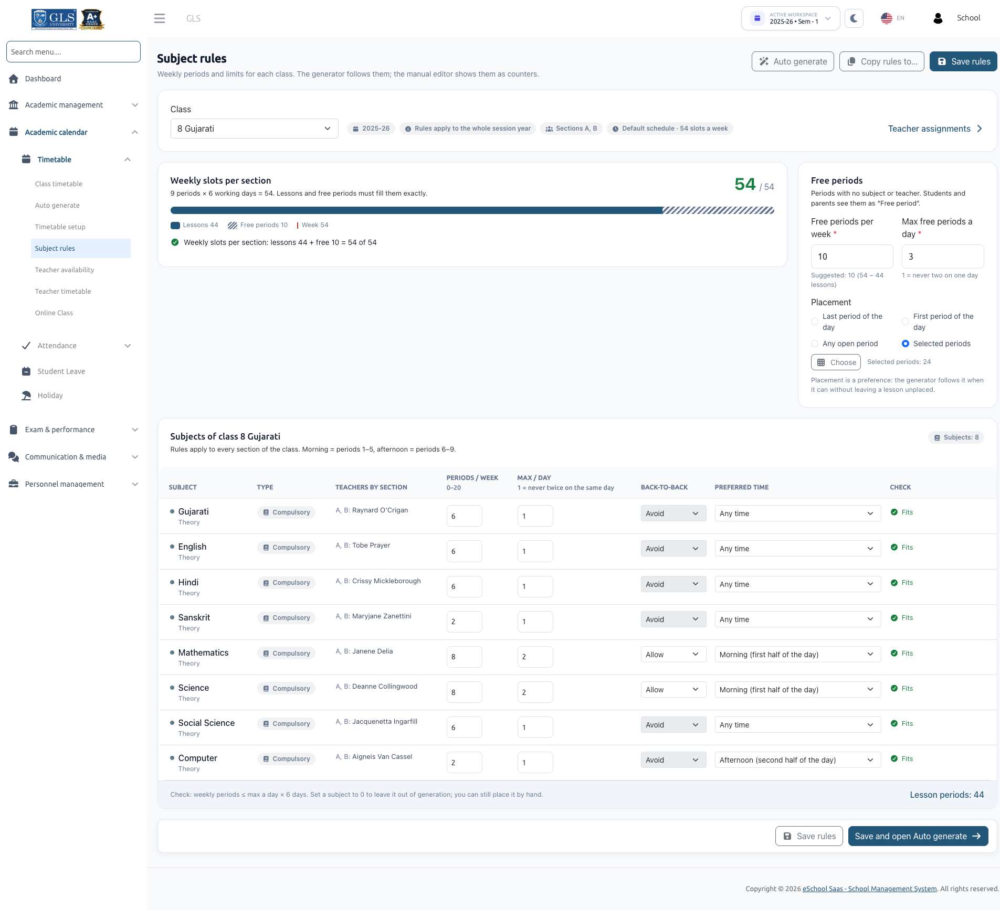
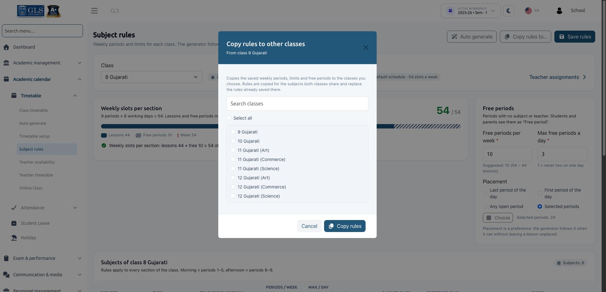

# Subject Rules



Subject Rules specify how many periods per week each subject needs, the maximum times a subject can be taught per day, preference for consecutive or spread-out periods, and the allocation of free periods. The auto generator strictly follows these rules, while the manual timetable editor reflects them as live counters.

:::info Prerequisites
To access and save Subject Rules, your role must have the `timetable-generate` permission. Rules are defined per **Class** and automatically apply across all sections of that class for the selected session year and semester.
:::

---

## 1. Selecting a Class

Open **Academic calendar &rarr; Timetable &rarr; Subject rules**.

1. Select a **Class** from the dropdown menu (e.g., *Class 8*).
2. If the class has no subjects mapped for the active semester, the system prompts:  
   *`"Class 8 has no subjects for 2026-27 · Sem - 1"`* alongside an **Assign subjects** button to navigate to the class subject assignment page.

---

## 2. The Subject Rules Table

The subject table lists all subjects associated with the selected class:

| Column | Description & Input Limits |
| :--- | :--- |
| **Subject** | Name of the subject (e.g., Mathematics, Science, English). |
| **Type** | Displays whether the subject is **Compulsory** or **Elective** (e.g., *"Elective · choose 1 of 3"* or *"Elective group · same period"* for parallel electives). |
| **Teachers by section** | Displays the assigned teacher for each section. If a teacher is unassigned, it indicates *"No teacher"*. |
| **Periods / week** | Number of lessons required each week (**0 to 20**). Setting **0** marks the subject as *"0 periods: left out of generation, place it by hand"*. |
| **Max / day** | Maximum occurrences allowed in a single day (**1 to 4**). E.g., `1` ensures the subject is never scheduled twice on the same day. |
| **Back-to-back** | Choose **Avoid** or **Allow**. This setting takes effect only when **Max / day** is set to 2 or more. |
| **Preferred time** | Placement preference for the subject: **Any time**, **Morning (first half of the day)**, or **Afternoon (second half of the day)**. |
| **Check** | Real-time validation indicator. Displays **Fits** if the weekly periods fit within the working days, or warns if the count is impossible (e.g., *"6 > 1 a day × 5 days"*). |

:::note Default Values for New Subjects
Newly assigned subjects default to **0 periods / week**, **Max / day = 1**, **Avoid back-to-back**, and **Any time**.
:::

---

## 3. Teacher Splits for Shared Subjects

When a subject is taught by multiple teachers within the same section (e.g., Section 8-A has two Science teachers):

1. A **Split** button appears in the Teachers column.
2. Clicking it opens the **Split between teachers** modal.
3. Distribute the periods among the assigned teachers. The allocated values **must add up exactly** to the subject's weekly periods (e.g., if total weekly periods is 6, Teacher A = 4 and Teacher B = 2).
4. Click **Remove split** to revert back to a single teacher taking all periods.

:::warning Single Teacher Allocation Warning
If multiple teachers are assigned to a section without a split, the readiness checks will assign all periods to one teacher and issue a warning:  
*`"Several teachers in 8-A and no split: Asha Nair takes all 6 periods."`*  
Note that parallel elective groups cannot be split because each subject in the elective group has its own distinct teacher.
:::

---

## 4. Configuring Free Periods

Free periods represent scheduled periods during which students have no active lecture or assigned teacher.

- **Free periods per week**: Total number of free periods for each section in the week. The system calculates the remaining slots and displays a suggestion (e.g., *"Suggested: 6 (42 − 36 lessons)"*); click **Use 6** to apply it instantly.
- **Max free periods a day**: Maximum free periods permitted on any single day (e.g., `1` prevents multiple free periods on the same day).
- **Placement**: Defines when free periods are ideally positioned:
  - **Last period of the day**: Recommended for early dismissal or study halls.
  - **First period of the day**: Suitable for staggered arrival schedules.
  - **Any open period**: Allows flexible placement anywhere in the bell schedule.
  - **Selected periods**: Click **Choose** to open an interactive period grid, tick the exact period slots that can be kept free, and click **Use these periods**.

---

## 5. Weekly Slots Balance: The Exact-Fit Rule

```text
Lessons per week + Free periods per week = Total weekly periods in the bell schedule
```

- **Too many periods**:  
  *`"Each section of class 8 needs 44 periods (38 lessons + 6 free) but a week has 42, 2 too many. Remove lesson periods or free periods."`*
- **Too few periods**:  
  *`"Each section of class 8 fills only 40 of the 42 periods in a week (34 lessons + 6 free), 2 short. Add lesson periods or free periods."`*

:::important Generation Requires Exact Fit
While you can save work-in-progress rules that do not balance yet, **timetable generation will not start** until every section adds up exactly to the total weekly slots. When a discrepancy occurs, quick-action buttons such as **Set free periods to 8** help automatically rebalance the slots.
:::

---

## 6. Saving & Copying Rules



### Action Buttons
- **Save rules**: Saves rules for the current class.
- **Save and open Auto generate**: Saves rules and navigates directly to the generation screen.
- **Copy rules to...**: Opens the **Copy rules to other classes** modal:
  1. Search and select the destination classes that share the same academic structure.
  2. Click **Copy rules**.
  3. The system copies the weekly periods, daily limits, preferences, and free period settings for all matching subjects shared between the classes.
- **Discard changes**: If you attempt to switch classes with unsaved edits, a confirmation dialog prompts you to either **Discard changes** or **Save and continue**.

---

## Next Steps
After configuring subject rules, configure teacher schedules and restrictions in [Teacher Availability](./teacher-availability.md).
