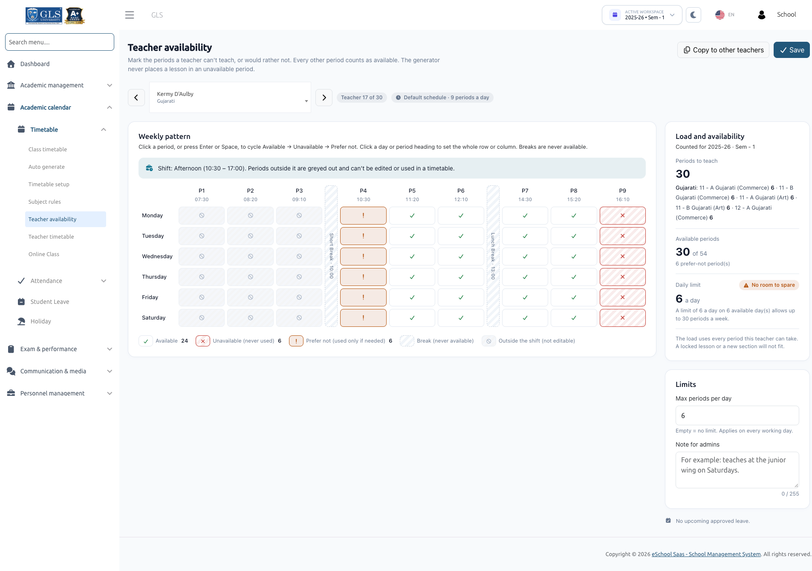

# Teacher Availability

Teacher Availability allows administrators to record when teachers can teach, when they cannot teach, and when they would prefer not to teach. The auto timetable generator strictly honors these constraints, ensuring teachers are never assigned to unavailable periods or outside their designated shifts.

:::info Prerequisites
To access Teacher Availability, your role must have the `timetable-generate` permission. Changes apply to the active session year and semester.
:::

---

## 1. Marking the Weekly Availability Pattern

Navigate to **Academic calendar &rarr; Timetable &rarr; Teacher availability**.

1. Select a teacher from the dropdown, or use the **Previous** and **Next** arrow buttons to browse through your staff members.
2. The **Weekly pattern** grid maps the school's working days horizontally across columns and the daily periods vertically down rows.
3. Click any individual slot (or highlight it and press <kbd>Enter</kbd> or <kbd>Space</kbd>) to cycle through the states:

| State | Visual Indicator | Meaning & Behavior |
| :--- | :--- | :--- |
| **Available** | Default White / Unmarked | The teacher is fully free to teach. This is the default state. |
| **Unavailable** | Red Marker | **Hard Constraint**: The generator will **never** schedule a lesson for this teacher in this period. |
| **Prefer not** | Yellow / Orange Marker | **Soft Constraint / Preference**: The generator actively avoids this period, but may schedule here as a last resort to avoid leaving a lesson unplaced. |
| **Break** | Grey / Static Marker | School breaks configured in Timetable Setup. Non-editable and cannot have lessons scheduled. |
| **Outside shift** | Greyed out / Locked | Periods falling outside the teacher's assigned shift hours. Cannot be edited or used. |

:::tip Quick Selection Shortcuts
Click any **Day heading** (e.g., *Monday*) or **Period heading** (e.g., *Period 1*) to toggle the entire row or column in a single click.
:::

---

## 2. Limits & Administrative Notes

Beneath the weekly pattern grid, configure the teacher's workload boundaries:

- **Max periods per day**: Sets an upper limit on how many lessons this teacher can teach on any single working day. Leave blank for no daily restriction.
- **Note for admins**: Free-form text notes for administrative reference (e.g., *"Available only in morning due to higher-studies coursework"*). The generator does not read this note.

### Real-Time Load & Availability Panel
The **Load and availability** panel dynamically tallies:
- **Periods to teach**: Sum of all assigned weekly periods across all classes and sections.
- **Available periods**: Total periods marked as available in the teacher's weekly grid.
- **Feasibility Alerts**: If the required teaching periods exceed the teacher's available slots or daily capacity, the panel warns you immediately with actionable guidance.

---

## 3. Copying Patterns to Other Teachers

To quickly apply a standard schedule (such as part-time patterns or shared shift restrictions):

1. Click **Copy to other teachers**.
2. Select the target teachers from the list.
3. Confirm the action.  
   - This copies the weekly pattern and daily period limits to the chosen teachers.
   - Any personalized administrative notes for the destination teachers are preserved.

:::note Upcoming Approved Leave
An **Upcoming approved leave** panel lists dates where the teacher has scheduled leave. Note that leave on specific dates is managed through the daily teacher substitution module, not through the recurring weekly availability pattern.
:::

---

## 4. Shift Integration & Clock-Time Validation

Teacher schedules integrate with your school's **Shifts** (configured in *Academics &rarr; Shift*):

- **Assigned Shift**: A teacher assigned to a shift (e.g., *Morning Shift: 07:30 – 13:00*) can only be scheduled within that shift's precise window. Any period starting before the shift begins or concluding after it ends is automatically greyed out and cannot be scheduled.
- **No Shift Assigned**: If a teacher is not linked to a specific shift, they can work within any time span covered by the school's active shifts combined (e.g., if Morning is `07:30 – 13:00` and Afternoon is `10:30 – 17:00`, the valid range is `07:30 – 17:00`).
- **No Active Shifts in School**: If your school operates without shifts, standard school hours from Timetable Setup apply.
- **Server Enforcement**: Shift validity is validated by exact clock times. If you attempt to save an out-of-bounds period, the system rejects it with an explicit message:  
  *`"Anita Rao works Morning (07:30 – 13:00), so period 8 (13:20 – 14:00) can't be set."`*

:::tip Assigning Shifts to Staff
To assign or modify a teacher's shift, update the **Staff Shift** field in *Personnel Management &rarr; Staff* or via the staff bulk import spreadsheet.
:::

---

## Next Steps
With Timetable Setup, Subject Rules, and Teacher Availability configured, you are ready to create your schedule with the [Auto Generate Timetable](./auto-generate.md).
