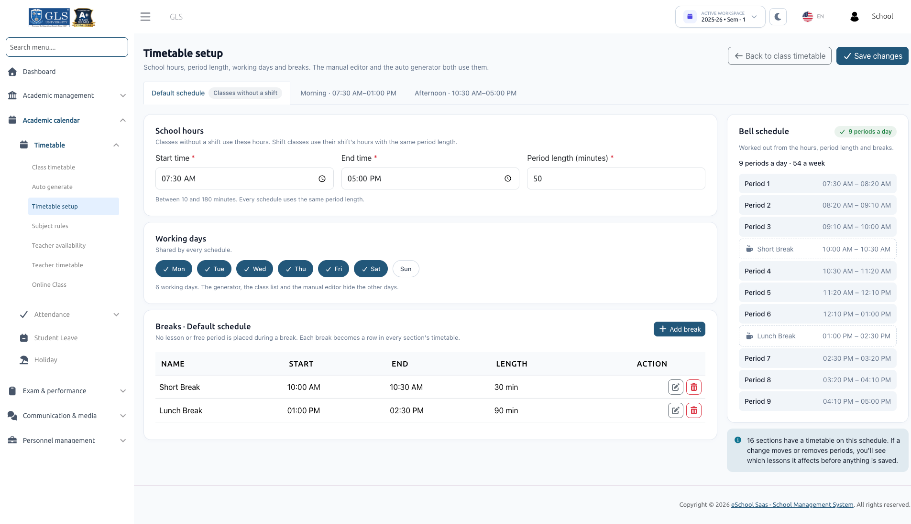

# Timetable Setup

Timetable setup defines the fundamental parameters of your school day: starting and ending hours, period length, working days, and scheduled breaks. Both the manual timetable editor and the auto timetable generator strictly adhere to these settings.

:::info Prerequisites
To access Timetable Setup, your user role must have the `timetable-create` permission. Ensure you are working in the correct active Session Year and Semester selected in the top workspace selector.
:::

---

## 1. Overview & Schedule Tabs

Navigate to **Academic calendar &rarr; Timetable &rarr; Timetable setup**.

The page is organized into schedule tabs:
- **Default schedule (Classes without a shift)**: Defines the primary schedule for standard classes not tied to any specific shift. Here, school administrators directly configure the **Start time** and **End time**.
- **Shift Tabs (e.g., Morning, Afternoon)**: If your school uses shifts (configured under *Academics &rarr; Shift*), each active shift displays its own dedicated tab with its specific start and end hours. 
  - On shift tabs, **Start time** and **End time** are read-only and inherited from the Shift settings page.
  - An **Edit shift hours** shortcut link is provided if you have permissions to manage shifts.
  - A class assigned to a shift automatically uses that shift's bell schedule and break times.

### Shared Schedule Settings
The following parameters are globally shared across all schedules:
- **Period length (minutes)**: Must be a whole number between **10** and **180** minutes. Every class period across all schedules follows this duration.
- **Working days**: Shared across all schedules. Click any day button (**Mon** through **Sun**) to toggle it on or off. At least one working day is required.

:::tip Suggested Working Days
Until saved, the working days are automatically suggested based on your school's **Leave settings** (e.g., if Sunday is marked as weekly off, Monday to Saturday is suggested). Click **Save changes** to confirm your working days.
:::

---

## 2. Managing Breaks

A break is a scheduled pause during the school day where neither lessons nor free periods can be scheduled. Each break is automatically represented as a dedicated row in every class section's timetable on every working day.

### Adding a Break
1. Configure and save the school hours and period length first.
2. Click **Add break**.
3. Fill in the required fields:
   - **Break name**: E.g., *"Lunch break"*, *"Morning Snack"*, *"Recess"*.
   - **Start time**: E.g., `10:40`.
   - **End time**: E.g., `11:00`.
4. Click **Save break**.

### Break Table & Actions
All scheduled breaks are listed in a table with the following details:
- **Name**: Name of the break.
- **Start**: Beginning time.
- **End**: Ending time.
- **Length**: Calculated duration in minutes.
- **Action**: Edit (pencil icon) or Delete (trash icon).

:::warning Break Alignment & Warnings
If a break starts in the middle of an ongoing lecture period, the setup page warns you:  
*`"Starts inside period 4 (10:00–10:40). 20 minutes before the break would be unused."`*  
The system will suggest an adjusted start time that aligns neatly with period boundaries so that zero minutes are wasted.
:::

---

## 3. Real-Time Bell Schedule

The **Bell schedule** panel on the right calculates and displays the resulting daily timetable structure in real time based on your configured hours, period length, and breaks:

- **Slot Count**: Displays total periods per day and weekly slots (e.g., *"7 periods a day · 42 slots a week"*).
- **Status Indicators**:
  - **Unsaved changes**: Indicates modified settings that have not yet been saved.
  - **Needs fixing**: Warns if the configured hours and period length cannot fit at least one complete period into the day.

### Example Bell Schedule Structure
| Period | Time | Type |
| :--- | :--- | :--- |
| **Period 1** | 08:00 – 08:40 | Lesson Slot |
| **Period 2** | 08:40 – 09:20 | Lesson Slot |
| **Period 3** | 09:20 – 10:00 | Lesson Slot |
| **Period 4** | 10:00 – 10:40 | Lesson Slot |
| **Lunch Break** | 10:40 – 11:00 | School Break |
| **Period 5** | 11:00 – 11:40 | Lesson Slot |
| **Period 6** | 11:40 – 12:20 | Lesson Slot |
| **Period 7** | 12:20 – 13:00 | Lesson Slot |

---

## 4. Saving Changes Affecting Existing Timetables

If your edits change the timing or number of periods such that existing live timetables or drafts would be impacted:

1. A confirmation modal titled **"This change affects existing timetables"** appears.
2. It lists all affected class sections and lessons that will fall out of alignment or into conflict.
3. It informs you how many open auto-generated drafts were generated using the old bell schedule and will need to be regenerated.
4. Select **Save anyway** only if you are ready to adjust or regenerate those timetables.

---

## Next Steps
After completing Timetable Setup, proceed to define weekly subject quotas and limits in [Subject Rules](./subject-rules.md).
