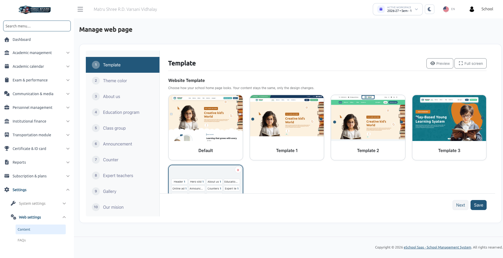
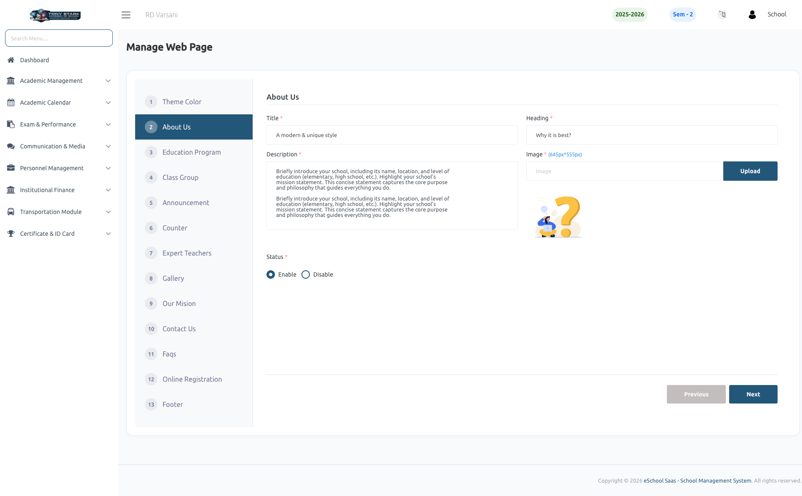

# Website Content & Sections

The **Content** section of Web Settings (accessed via **Settings &rarr; Web settings &rarr; Content**) allows school administrators to write the text, upload images, configure educational programs, and control section visibility for the public school website.

:::info Step Navigation & Saving
The interface presents a sequence of 14 configuration steps on the left sidebar. Use the **Previous** and **Next** buttons to navigate through steps. Click **Save** at the bottom of a step to apply changes to that specific section.
:::

---

## 1. Overview of Content Steps (Steps 3–14)

While Step 1 (**Template**) and Step 2 (**Theme color**) dictate presentation and brand colors (detailed in [Website Templates & Designer](./website-templates.md)), Steps 3 through 14 govern website content:

| Step # | Section Name | Content & Output Location | Recommended Image Dimensions |
| :--- | :--- | :--- | :--- |
| **3** | **About us** | Introduction text, historical background, and main campus picture. Displayed on the home page and About Us page. | `645px &times; 555px` |
| **4** | **Education program** | Introductory title, headline, and description introducing the school's academic streams. Programs themselves are managed in Step 5. | None |
| **5** | **Class group** | The educational programs/curricula offered by the school (e.g., *Primary School*, *Secondary School*). | `308px &times; 397px` |
| **6** | **Announcement** | Banner headline, description, and feature image for the home page noticeboard. Real announcements pull from the Announcement module. | `595px &times; 496px` |
| **7** | **Counter** | Metric statistics headline, description, and four category icons used by Template 2 (*Teachers*, *Students*, *Classes*, *Streams*). | `248px &times; 210px` |
| **8** | **Expert teachers** | Headline and description for the faculty showcase. Qualified teachers are populated automatically from staff records. | None |
| **9** | **Gallery** | Showcase headline and introductory text. Photo and video albums are managed in the main Gallery module. | None |
| **10** | **Our mision** | School mission statement, key pillar points, and feature illustration. Displayed on the public About Us page. | Standard image |
| **11** | **Contact us** | Custom headline and greeting text displayed above the inquiry form and campus map on the Contact Us page. | None |
| **12** | **FAQs** | Introductory headline and description for the frequently asked questions accordion. Specific Q&A items are managed under [FAQs](./faqs.md). | None |
| **13** | **Online registration** | Call-to-action banner, promotional copy, and feature image encouraging prospective student enrollment. | `595px &times; 496px` |
| **14** | **Footer** | School brief summary, footer logo, copyright text, and social media profile URLs. | Footer Logo |

---

## 2. Standard Field Requirements

Most content steps share a standardized form structure:

- **Title**: A concise category tag displayed above the main headline (e.g., *About Greenfield*, *Admissions Open*).
- **Heading**: The prominent bold headline of the section (e.g., *Nurturing Excellence in Every Learner*).
- **Description**: A descriptive introductory paragraph providing context for visitors.
- **Image**: Supported formats include **JPEG, PNG, SVG, and WebP**. Recommended pixel dimensions are noted beside upload fields. Uploading images close to the recommended resolution prevents stretching or unwanted cropping.
- **Status**: Toggle between **Enable** (display on website) and **Disable** (hide from website).

:::warning Mandatory Field Validation
The **Title**, **Heading**, and **Description** fields marked with a red asterisk are strictly required to proceed, **even if the section is disabled**. If left empty, clicking Next or Save prompts:  
*`"Please fill all required fields."`*
:::

---

## 3. Specialized Section Walkthroughs

### Class Group Step (Educational Programs)
The **Class group** step features a dedicated management table:

1. Click **Create class group**.
2. Enter the program **Name** (e.g., *Pre-Primary*, *Middle School*, *Senior Secondary*).
3. Provide a brief **Description** summarizing the curriculum focus.
4. Upload a thumbnail **Image** (recommended `308px &times; 397px`).
5. Select the **Classes** that belong to this academic division.
6. Click **Submit**.

:::tip Template 2 Hover Interaction
In **Template 2**, class group cards display the program name and image by default, and reveal the description in an animated overlay when hovered over with a mouse pointer.
:::

---

### Counters Step (Automated Tallies)
The statistical numbers displayed in the Counters section (*Total Teachers*, *Active Students*, *Classes*, and *Streams*) are **calculated automatically by the system** in real time from your active school database. Administrators only configure the section text and the four optional category graphics used in Template 2.

---

### Our Mission Step (Bulleted Pillars)
In Step 10 (**Our mision**), enter your school's core institutional values under **Points**:
- Type a key pillar (e.g., *Academic Rigour*, *Holistic Development*, *Character Building*).
- Press <kbd>Enter</kbd> or type a comma to add the point to the pill list.
- These points display as an itemized checklist beside your mission statement on the public About Us page.

---

### Footer Step (Social Media & Copyright)
- **Short Description**: Explanatory paragraph positioned beneath the school crest in the website footer.
- **Footer Logo**: Optional alternative logo (e.g., white-monochrome variant) for dark footer backgrounds. If omitted, the primary school logo is used.
- **Footer Text**: Copyright attribution line (e.g., *&copy; 2026 Greenfield Public School. All Rights Reserved*).
- **Social Media Links**: Paste full URLs for your school's official **Facebook**, **Instagram**, **LinkedIn**, and **Twitter** profiles. Social icons only render for URLs that are filled in.

---

## 4. Content Managed on Other System Screens

To keep administration streamlined, dynamic modules populate the public website automatically from their respective administrative sections:

| Feature | Managed Location | Integration Behavior |
| :--- | :--- | :--- |
| **Hero Slider Banners** | Main Menu &rarr; **Sliders** | Upload slider images with type set to **School website** or **Both**. Supports optional target web links. |
| **Frequently Asked Questions** | Settings &rarr; Web settings &rarr; **FAQs** | Questions and detailed answers render dynamically in the FAQ accordion on the home page. |
| **Announcements & Notices** | Main Menu &rarr; **Announcement** | The home page automatically displays up to the 10 most recent general announcements not restricted to a single class subject. |
| **Photo & Video Albums** | Main Menu &rarr; **Gallery** | Published albums appear on the home page and on the dedicated public Gallery page with full-resolution photo viewers. |
| **Faculty Showcase** | Personnel &rarr; **Staff** | The *Expert Teachers* section lists active teachers and their academic qualifications automatically. |
| **Legal Pages** | Settings &rarr; **Terms & Conditions**, **Privacy Policy**, **Refund Cancellation** | Full legal text renders on matching public website pages. |

---

## 5. Public Website Navigation Menu

The header navigation menu of your public website automatically adapts based on your section status toggles:

| Navigation Item | Display Condition |
| :--- | :--- |
| **Home** | Always visible. |
| **About Us** | Displayed if either *About us* or *Our mision* is enabled. |
| **Gallery** | Displayed if the *Gallery* section is enabled. |
| **FAQs** | Displayed if *FAQs* is enabled **and** at least one FAQ has been added. |
| **Contact Us** | Displayed if the *Contact us* section is enabled. |
| **Login** | Always visible. Opens a dropdown with *Login with Staff* and *Login with Student*. |
| **Admission Open** | Rendered as a prominent call-to-action button when *Online registration* is enabled. |

---

## 6. Troubleshooting Common Issues

| Issue | Likely Cause | Solution |
| :--- | :--- | :--- |
| *"Please fill all required fields"* | A required text field (**Title**, **Heading**, or **Description**) is empty in the current step. | Fill in all asterisked text boxes, even if the section status is disabled. |
| Changes saved but website looks unchanged | The browser is displaying a cached version, or a different step was saved. | Click **Save** on the specific step you edited, then perform a hard refresh (<kbd>Ctrl</kbd> + <kbd>F5</kbd> or <kbd>Cmd</kbd> + <kbd>Shift</kbd> + <kbd>R</kbd>) on the public website. |
| A section is missing on the home page | The section switch is disabled, or content is missing at the source. | Verify the section switch is **On**. Ensure class groups exist for Programs, announcements exist for Announcements, and albums exist for Gallery. |
| Hero slider is missing | Slider Management is absent from your plan, or no banners are assigned to the website. | Check your subscription package and ensure sliders in the Sliders module have type set to **School website** or **Both**. |
| Images look cropped or distorted | Image resolution does not match the recommended aspect ratio. | Resize and upload images matching the pixel dimensions indicated beside each field. |

---

## Related Documentation
- [Website Templates & Designer](./website-templates.md): Select templates, mix section variations, and configure brand colors.
- [FAQs](./faqs.md): Create questions and answers for the website FAQ section.