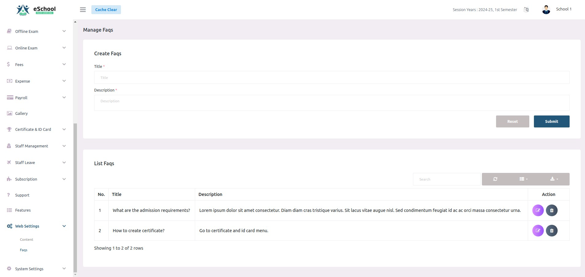

# FAQs

The **FAQs** module (located under **Settings &rarr; Web settings &rarr; FAQs**) allows school administrators to manage frequently asked questions and answers displayed in the interactive FAQ accordion on the public school website.

---

## 1. Managing FAQs

1. Navigate to **Settings &rarr; Web settings &rarr; FAQs**.
2. **Adding an FAQ**:
   - Click **+ Add FAQ** or fill in the creation form.
   - **Title**: Enter the question (e.g., *What is the admission procedure for the upcoming academic year?*).
   - **Description**: Provide the detailed answer with full instructions or links.
   - Click **Submit**.
3. **Editing or Deleting**:
   - Use the **Edit** (pencil icon) to update existing questions or answers.
   - Use the **Delete** (trash icon) to remove questions no longer relevant.

---

## 2. Public Website Display & Navigation Rules

- **Home Page Accordion**: Published FAQs render in a clean, expandable accordion within the FAQs section on the home page.
- **Header Menu Integration**: The **FAQs** item appears in the website header navigation menu only when the FAQs section is **Enabled** in [Website Content](./content.md) **and** at least one FAQ item has been created.
- **Section Introduction**: To customize the headline and descriptive subtitle shown above the FAQ accordion, navigate to Step 12 (**FAQs**) in [Website Content & Sections](./content.md).

---

## Related Documentation
- [Website Templates & Designer](./website-templates.md): Select home page templates and customize brand colors.
- [Website Content & Sections](./content.md): Configure website text, images, and section visibility.