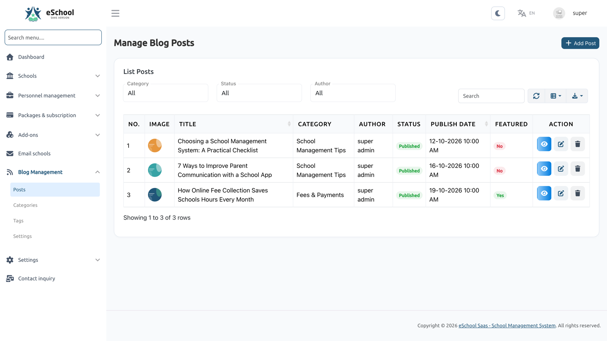
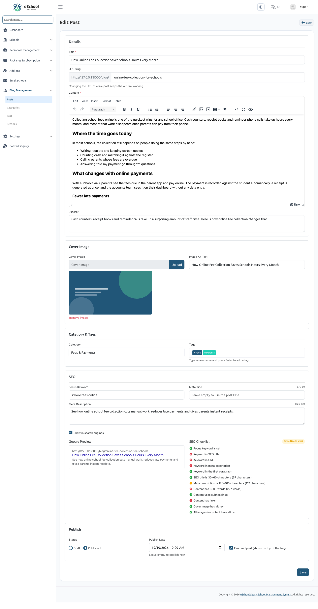
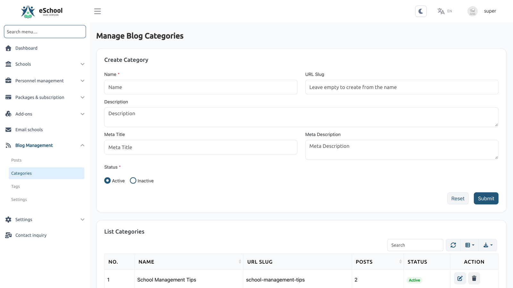
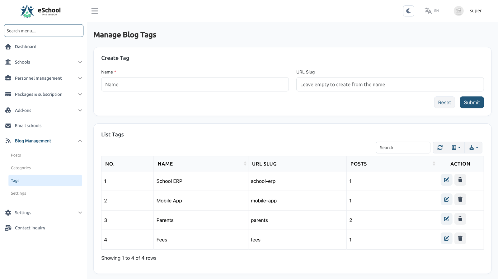
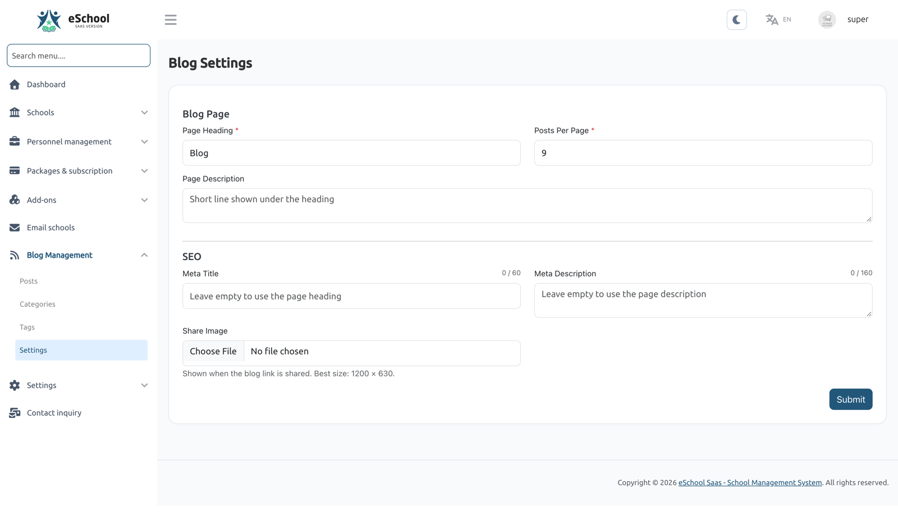
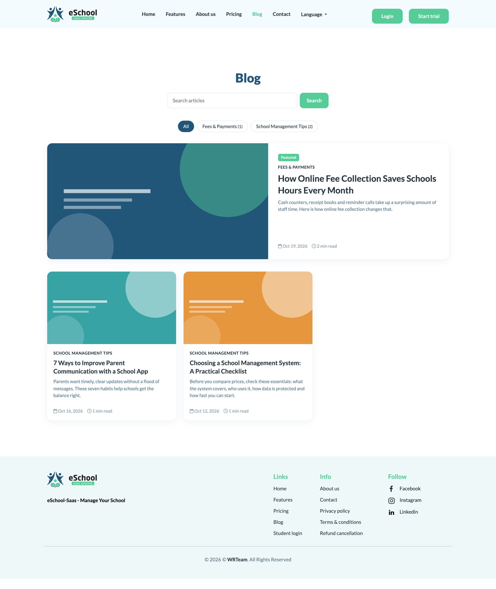
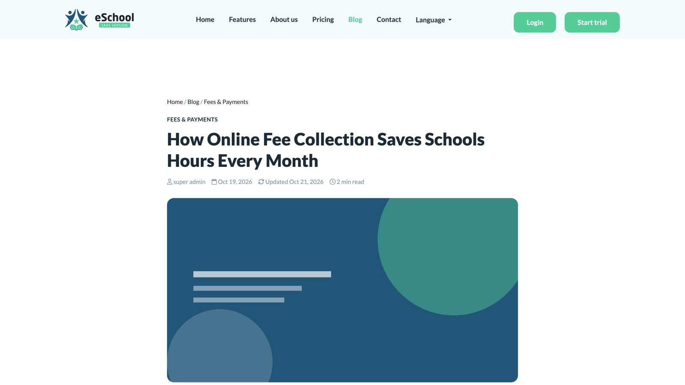

# Blog Management

The Super Admin can publish a **blog on the business website** (the main domain). Posts, categories, tags and the blog page itself are managed from **Blog Management** in the Super Admin panel.

The blog only exists on the main website. School websites on their own domains do not have it (`/blog` returns *404* there).

---

## 1. Menu and permissions

**Blog Management → Posts / Categories / Tags / Settings**

| Permission | Allows |
|---|---|
| `blog-post-list`, `blog-post-create`, `blog-post-edit`, `blog-post-delete` | Posts |
| `blog-category-list`, `blog-category-create`, `blog-category-edit`, `blog-category-delete` | Categories |
| `blog-tag-list`, `blog-tag-create`, `blog-tag-edit`, `blog-tag-delete` | Tags (`blog-tag-create` also allows adding new tags while writing a post) |
| `blog-settings` | Blog page settings |

The Super Admin has all of them. They can also be given to other Super Admin staff roles through **Role & Permission**.

---

## 2. Posts

**Blog Management → Posts**

The list shows each post's cover image, title, URL, category, tags, author, status and publish date. You can filter by **status** (Draft / Scheduled / Published), **category** and **author**, and search by ID, title or URL.

Row actions:

| Action | What it does |
|---|---|
| **View / Preview** | Opens the post on the website. A draft or scheduled post opens as a **preview** that only signed-in staff with post permissions can see |
| **Edit** | Opens the post editor |
| **Delete** | Deletes the post, its cover image, and editor images that no other post uses |

### Writing a post

Click **Add Post**.

**Details**

| Field | Notes |
|---|---|
| **Title** | Required |
| **URL slug** | Optional. Created from the title if left empty, and made unique automatically (`-2`, `-3`, …). A slug you type must not already be used: *"This URL is already used by another post."* |
| **Content** | Required. Rich text editor with headings, lists, tables, links, images and YouTube / Vimeo embeds |
| **Excerpt** | Short summary shown on the blog list (up to 500 characters) |
| **Category** | Optional |
| **Tags** | Pick existing tags, or type a new name and press Enter (needs `blog-tag-create`) |
| **Cover image** | JPG, PNG or WEBP, up to the system upload size limit. Add **Image alt text** to describe it for Google and screen readers |
| **Featured post** | Shows the post on top of the blog's main page |

**Publishing**

| Status | Publish date | Result |
|---|---|---|
| **Draft** | Any | Not on the website. Preview only |
| **Publish** | Empty | **Live now** |
| **Publish** | In the past | Live, with that date |
| **Publish** | In the future | **Scheduled**: goes live automatically at that time (no cron needed) |

**SEO**

| Field | Notes |
|---|---|
| **Meta title** | Leave empty to use the post title |
| **Meta description** | Leave empty to use the excerpt |
| **Focus keyword** | The main phrase people search for |
| **Show in search engines** | On by default. Turn off to add `noindex` to the post and leave it out of the sitemap |

The editor shows a **Google preview** and a live **SEO checklist** (Good / Needs work / Poor):

- Focus keyword is set
- Keyword in SEO title, URL, meta description and the first paragraph
- SEO title is 30–60 characters
- Meta description is 120–160 characters
- Content has 600+ words, uses subheadings and has links
- Cover image has alt text, and all images in the content have alt text

The checklist is guidance only. It does not block saving.

### Changing the URL of a live post

If you change the slug of a post that is **already live**, the old link keeps working: visitors and Google are sent to the new URL with a permanent (301) redirect. The old URL stays reserved, so no other post can take it.

### Content safety

Because staff can write posts, the HTML is cleaned when a post is saved. Scripts, forms, event handlers, `javascript:` links and embeds other than **YouTube** and **Vimeo** are removed.

### Images

- Images inserted from the editor are uploaded to the server at full quality.
- When an image is removed from a post, or the post is deleted, the file is deleted too, unless another post still uses it.
- For link previews (WhatsApp, Facebook, X), a large cover is shown through a smaller 1200 px copy that is made automatically. The original is never changed.

---

## 3. Categories

**Blog Management → Categories**

| Field | Notes |
|---|---|
| **Name** | Required |
| **Slug** | Optional, created from the name and kept unique |
| **Description** | Optional |
| **Meta title / Meta description** | SEO for the category page |
| **Status** | Active or Inactive. An inactive category's page is not shown on the website |

A category that still has posts cannot be deleted: *"This category has posts. Move them to another category first."*

## 4. Tags

**Blog Management → Tags**

Tags have a name and a slug. Each tag gets its own page on the website listing its posts. Tags can also be created while writing a post.

---

## 5. Blog page settings

**Blog Management → Settings**

| Field | Notes |
|---|---|
| **Page heading** | Required. Heading of the `/blog` page (defaults to "Blog") |
| **Page description** | Optional text under the heading |
| **Meta title / Meta description** | SEO for the blog's main page |
| **Posts per page** | 3–48, default 9 |
| **Share image** | Optional, best size 1200 × 630. Preview image for links to the blog pages, and for posts without a cover image. If empty, the website logo is used (SVG logos are skipped, because social networks don't show them) |

---

## 6. On the website

| URL | Shows |
|---|---|
| `/blog` | All live posts, newest first, with search, categories and pagination. The latest **featured** post sits on top of page 1 |
| `/blog/{slug}` | A post, with reading time, share buttons and up to 3 related posts (same category, then same tags, then newest) |
| `/blog/category/{slug}` | Posts in an active category |
| `/blog/tag/{slug}` | Posts with a tag |

- The home page shows a **"Latest From Our Blog"** section with the 3 newest posts.
- A **Blog** link appears in the website menu and footer **only once at least one post is live**.

### SEO built in

- Meta description, canonical URL, Open Graph and X (Twitter) cards on every blog page.
- Structured data (JSON-LD): BlogPosting, Blog and BreadcrumbList.
- `/sitemap.xml` lists the live posts (except those hidden from search engines), and `/robots.txt` points to it.

:::note
Updates do not delete files. If your install still has an old `public/robots.txt`, delete it so the new dynamic `/robots.txt` (which points to the sitemap) is served.
:::
