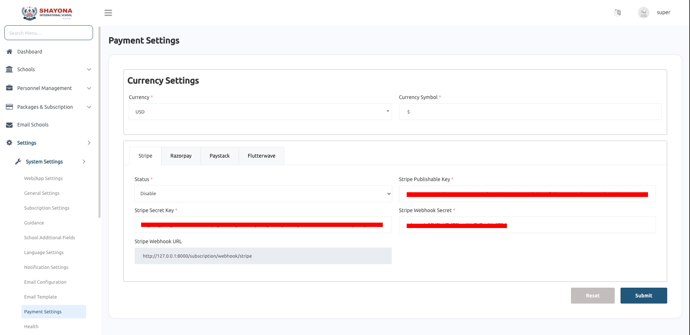

# Payment Settings

- We offer four types of payment gateways: Stripe, Razorpay, Paystack and Flutterwave, allowing secure and flexible payment processing for seamless transactions.

- 1. [Stripe](https://stripe.com)
- 2. [Razorpay](https://razorpay.com) 
- 3. [Paystack](https://paystack.com)
- 4. [Flutterwave](https://flutterwave.com)

## Manual Payment

The **Manual Payment** tab lets schools pay their subscription bills, plans and add-ons by bank transfer and upload the payment proof. Set **Status** to *Enable* and fill in **Bank Details & Payment Instructions**, which schools see when they pay. The plan or add-on starts right away and the payment waits for your review.

See [Manual Payments & Cheques](../../packages-subscription/manual-payments-cheques.md) for the full flow.