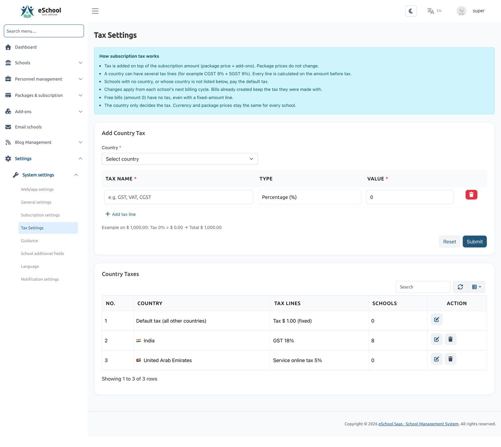
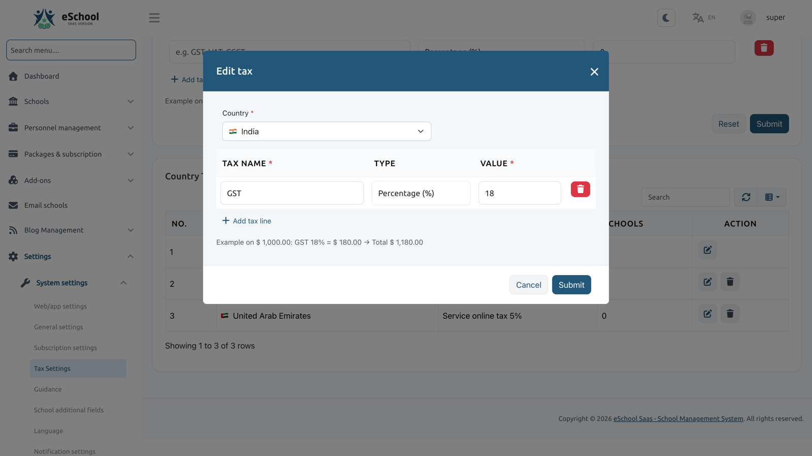

# Tax Settings (Country-wise Subscription Tax)

**Settings → Tax Settings** (needs the `tax-settings` permission)



The Super Admin can charge tax on school subscription payments based on each school's **billing country**. A country can have one or more tax lines (for example *CGST 9% + SGST 9%*), and a **default tax** covers every other school.

The tax is **added on top** of the subscription amount. Package prices and the currency stay the same for every school; the country only decides the tax.

---

## 1. How it works

| Rule | Detail |
|---|---|
| **Tax per country** | Each country can have several tax lines. Each line is either a **percentage** or a **fixed amount** |
| **Default tax** | Schools with no country, or whose country has no tax set, pay the **default tax**. It starts at 0% and cannot be deleted |
| **No tax on tax** | Every line is calculated on the amount **before tax** |
| **Added on top** | Tax is added to the subscription amount (package price + add-ons). Package prices do not change |
| **Free bills** | A bill of amount 0 has **no tax**, even if a fixed-amount line exists |
| **Next cycle** | Changes apply from each school's **next billing cycle**. Bills already created keep the tax they were made with |

**Example.** India has *CGST 9%* and *SGST 9%*. A school in India with a bill of 1,000 pays 1,000 + 90 + 90 = **1,180**. A school in any country without its own tax pays the default tax.

---

## 2. Add a country tax

1. Open **Settings → Tax Settings**.
2. In **Add country tax**, select the **Country**.
3. Add one or more **Tax lines**. For each line enter:
   - **Tax** name, for example *GST*, *VAT* or *CGST* (up to 50 characters);
   - **Type**: *Percentage (%)* or *Fixed amount*;
   - **Value**: a percentage cannot be more than 100.
4. The form shows a live example of the tax on a sample amount.
5. Click **Submit**.

Each country can be added only once. To change it later, edit it in the list.



### Validation

| Message | Cause |
|---|---|
| "Select a country for each country tax." | No country, or an unknown one, was selected |
| "This country already has a tax. Edit it in the list below." | The country is already in the list |
| "Keep at least one tax line. Set its value to 0 for no tax." | All lines were removed |
| "A percentage tax cannot be more than 100%." | A percentage line is above 100 |

---

## 3. The country taxes list

The list shows the **Default tax (all other countries)** first, then every country by name. For each row you see:

- the **tax lines**, for example *CGST 9% + SGST 9%* or *Service fee $ 50.00 (fixed)*;
- the number of **Schools** that pay this tax right now. For the default row, this counts schools with no country plus schools whose country has no tax of its own.

Actions:

| Action | What it does |
|---|---|
| **Edit** | Change the tax lines. A country row can also be moved to another country that has no tax yet |
| **Delete** | Removes a country's tax; its schools then pay the default tax from their next cycle. The **default tax cannot be deleted**: set it to 0% for no tax |

---

## 4. The school's billing country

The tax depends on the school's **billing country**. It is optional and can be set in several places:

| Where | Who |
|---|---|
| **Schools → Create / Edit school** (Country field; the school list also has a country column and filter) | Super Admin |
| Public school **registration** form, and **school inquiry** approval | School / Super Admin |
| **General Settings → Country (for billing)** in the school panel | School Admin |

When the country changes, the **other side is emailed**:

- changed by the Super Admin: the school gets *"Your billing country was updated"*, with the old and new country and the tax for the new country;
- changed by the school: the Super Admin gets *"Billing country changed by \[school\]"*.

The new tax applies from the school's **next billing cycle**.

Until a school sets its country, the School Admin dashboard shows a **reminder** to set it. The **Email Schools** page has a ready-made *"Set your country"* email and an option to select the schools that have no country.

---

## 5. Where the tax is applied

When a school's subscription cycle starts, its tax lines are **copied onto that cycle**. Bills and add-ons of that cycle use this copy, so later changes to the country or to Tax Settings do not change them.

| Payment | Tax |
|---|---|
| **Bill** (postpaid cycle bill) | All tax lines of the cycle, on the bill amount |
| **Prepaid plan** (new plan, plan change, renewal) | All tax lines, on the package price |
| **Prepaid add-on** bought separately | **Percentage lines only**. Fixed lines are charged once per cycle, on the plan payment |
| **Postpaid add-on** | Part of the cycle bill, taxed there |
| **Free bill** (amount 0) | No tax |

Every way of paying charges the total including tax: Stripe, Razorpay, Paystack, Flutterwave, [Manual Payment](../../packages-subscription/manual-payments-cheques.md), cheque or cash recorded by the Super Admin, and plans assigned by the Super Admin.

What schools see:

- **Plans** and **Add-ons** pages show *price + tax = you pay*. Public pricing and plan amounts are marked **excl. tax**.
- The bill popup and the payment form list each tax line.
- The **receipt** shows the amount before tax, each tax line, the total including tax, the payment date and the tax country.
- Bills from before this feature have no tax and show *Tax (0%)*.

---

## 6. After updating

Existing installs get a default tax of **0%**, so nothing changes until you add taxes. To check subscription tax data after the update, run this read-only command:

```bash
php artisan subscription-tax:check
```
