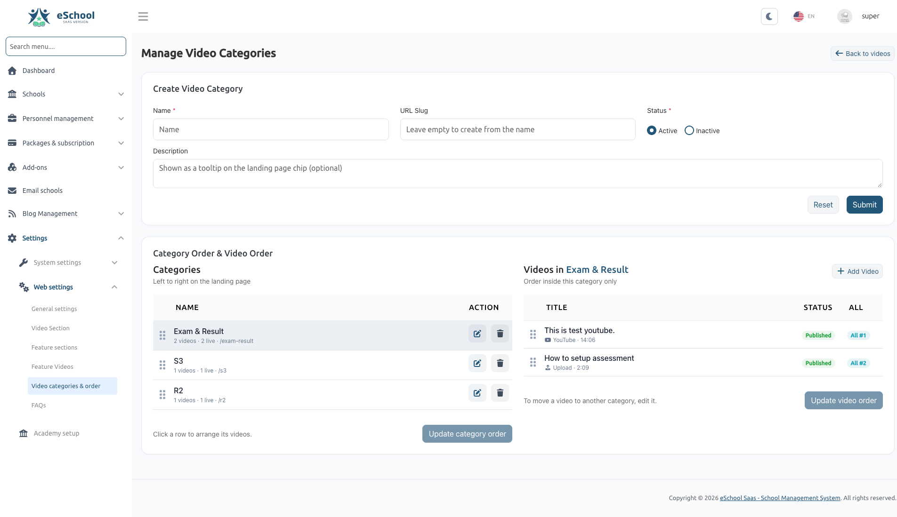
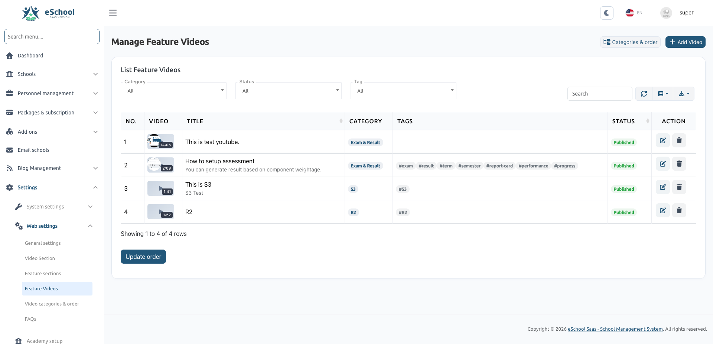
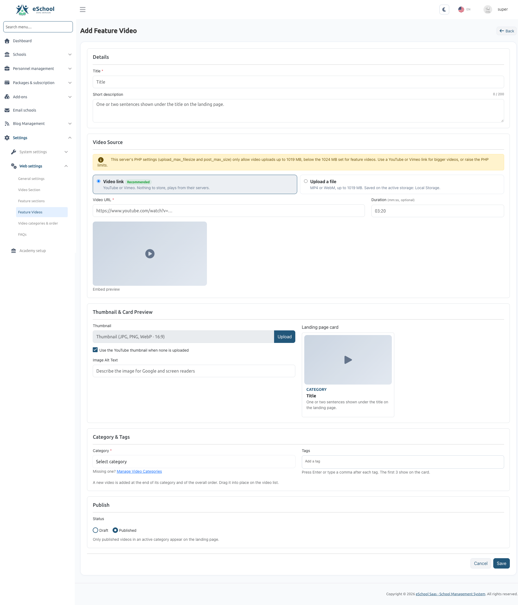

# Feature Videos — User Guide

*A complete guide for Super Administrators on how to manage feature walkthrough videos, organize them by category, control their display order, and showcase them on the public landing page.*

---

## Overview

The **Feature Videos** module allows the Super Administrator to showcase short video walkthroughs of eSchool SaaS features directly on the main public landing page.

Prospective school administrators and visitors can explore how key features work (such as *Admissions*, *Fee Management*, *Online Examinations*, *Staff Attendance*, or the *Mobile App*) without needing to log in or test everything manually.

### What you can do:
1. **Add videos via link or direct upload:** Embed YouTube or Vimeo videos, or upload your own MP4 / WebM video files.
2. **Organize into categories:** Group walkthroughs by topic (e.g., *Student Management*, *Finance & Fees*, *Academics*).
3. **Control exact display order:** Choose which category appears first and which video plays first using simple drag-and-drop reordering.
4. **Customize the section header:** Set your own heading, tagline, and introductory text from Web Settings.
5. **Turn on/off with Draft mode:** Keep videos in draft while preparing content, then publish when ready.

---

## 1. Who Can Access This Feature

Only the **Super Administrator** can manage feature videos. Individual school tenants cannot see or edit this section.

### Required Permissions
To access the screens, your user account must have the following permissions:
- **Feature Videos:** `feature-video-list`, `feature-video-create`, `feature-video-edit`, `feature-video-delete`
- **Video Categories:** `feature-video-category-list`, `feature-video-category-create`, `feature-video-category-edit`, `feature-video-category-delete`

If these menu options do not appear in your admin sidebar, verify your Super Admin role permissions under **Personnel Management → Role & Permission**.

---

## 2. Where to Find It in the Admin Panel

In the left-hand sidebar of the Super Admin panel, expand **Web Settings**:

```
Web Settings
├── General Settings
├── Video Section                   ← Set headings, subtitle, and intro text
├── Feature Sections
├── Feature Videos                  ← Add, edit, filter, and reorder videos
└── Video Categories & Order        ← Manage categories and visual ordering board
```

---

## 3. Key Concepts to Understand

| Concept | Explanation |
| :--- | :--- |
| **Category** | A group of related videos (e.g. *Academics*, *Fee Management*). Each active category becomes a clickable tab/chip on the landing page. |
| **Published vs. Draft** | **Published:** Visible to visitors on the public landing page.<br/>**Draft:** Hidden from visitors, visible only to Super Admins for review. |
| **Video Link (URL)** | Recommended for fast loading. Paste any standard YouTube or Vimeo link. YouTube links automatically fetch high-resolution thumbnails. |
| **Video Upload** | Upload an MP4 or WebM video file directly from your computer. Files are stored on your active storage provider (Local, AWS S3, or Cloudflare R2). |
| **Tags** | Keywords (e.g. `#attendance`, `#fees`, `#mobile-app`) displayed on video cards to help visitors find topics of interest. |
| **Ordering Model** | You control two levels of ordering:<br/>1. **Category Order:** Which category tab appears first on the website (left to right).<br/>2. **Video Order:** Which video card appears first within a category, and in the overall "All" tab. |

---

## 4. Customizing the Landing Page Section (Web Settings)

Before adding videos, you can customize the titles and introductory text displayed above the video cards on the public homepage.

1. Go to **Web Settings → Video Section** (or open **Web Settings** and scroll to the **Video Section** block).
2. Fill in the fields:
   - **Title (Tagline):** The colored accent label displayed at the top. *(Default: "See it in action")*
   - **Heading:** The main section heading. *(Default: "Learn eSchool in minutes")*
   - **Description:** A brief introductory paragraph explaining what the videos are about. *(Default: "Short walkthroughs of the features you will use every day. Pick a topic or start from the top.")*
3. Click **Submit** to save your changes.

---

## 5. Step-by-Step: Managing Categories & Ordering

*Menu location: **Web Settings → Video Categories & Order***

This screen is divided into two sections:
- **Top form:** Create new categories.
- **Bottom board:** An interactive two-pane ordering workspace for arranging categories and their respective videos.



### 5.1 Create a Category
1. Fill in the **Create Video Category** form:
   - **Name (Required):** The category name (e.g. *Academics & Timetable*).
   - **URL Slug (Optional):** A unique web-friendly identifier. If left blank, the system automatically creates one from the name.
   - **Status:** Choose **Active** (visible on landing page) or **Inactive** (temporarily hidden).
   - **Description (Optional):** A brief note (up to 250 characters). On the website, this appears as a helpful tooltip when hovering over the category chip.
2. Click **Submit**. The category appears immediately in the ordering list below.

### 5.2 Edit a Category
1. In the categories list on the left, click the blue **Edit (pencil)** button next to any category.
2. An edit modal appears. Update the name, slug, description, or status.
3. Click **Submit**.

### 5.3 Delete a Category
- Click the red **Delete (trash)** button next to a category.
- **Safety Protection:** You cannot delete a category if it still contains videos. If you attempt to do so, the system will prevent the deletion. You must first move or delete its videos.

### 5.4 Reorder Categories (Change Tab Order on Landing Page)
Categories appear on the landing page from left to right based on this order.
1. On the left pane under **Categories**, click and drag the handle (`:::`) or any row to move it up or down.
2. An orange badge **"Unsaved order changes"** will appear.
3. Click the **Update category order** button to save the new order.

### 5.5 Reorder Videos Inside a Category
1. Click on any category row in the left pane.
2. The right pane will immediately load all videos belonging to that category with their status and overall ordering badge (e.g., `All #1`).
3. Drag and drop the video rows into your desired sequence using the drag handle (`:::`).
4. Click **Update video order** to save.

:::note Moving a Video to Another Category
To move a video from one category to another, edit the video itself from **Feature Videos** and change its assigned category.
:::

---

## 6. Step-by-Step: Adding and Managing Videos

*Menu location: **Web Settings → Feature Videos***

### 6.1 View and Filter the Video List
The main video list gives an instant overview of all videos with their thumbnail poster image, playback duration badge, title, category, tags, and status.



- **Category Filter:** Filter by a specific category.
- **Status Filter:** Switch between *All*, *Published*, or *Draft*.
- **Tag Filter:** Filter by specific feature tags (e.g. `#attendance`, `#fees`).
- **Search bar:** Type any keyword to search across video titles and descriptions.
- **Top Quick Links:** Use the **Categories & order** button to jump directly to the category board, or click **+ Add Video** to create a new walkthrough.

:::note Drag-and-Drop Ordering Note
When any filter or search query is active, row reordering is temporarily locked to prevent accidental sequence errors. Clear your filters to enable full list reordering.
:::

---

### 6.2 Add a New Feature Video

Click the **+ Add Video** button in the top right to open the video editor.



#### Step 1: Details
- **Title (Required, max 120 characters):** Enter a clear, action-oriented title (e.g. *"How to Collect Fees Online"* or *"Automated Timetable Generation"*).
- **Short Description (Optional, max 200 characters):** A one- or two-sentence summary shown under the title on the card and in the video player dialog.

#### Step 2: Choose Video Source
Select between two source types:

**Option A: Video Link (Recommended)**
- Paste the full link from **YouTube** or **Vimeo** into the **Video URL** field.
  - *YouTube examples:* `https://www.youtube.com/watch?v=...`, `https://youtu.be/...`, `https://youtube.com/shorts/...`
  - *Vimeo examples:* `https://vimeo.com/...`
- The system automatically verifies the link and displays a green **"Link recognised"** badge.
- **Duration (Optional):** Enter the video length in `mm:ss` format (e.g. `03:20` for 3 minutes 20 seconds).
- A video player preview will load so you can verify playback before saving.

**Option B: Upload a File**
- Choose this option if you want to host the video directly without third-party branding.
- Click **Upload** and select an **MP4** or **WebM** file from your computer.
- The screen shows the maximum file size allowed by your server.
- While saving, a progress bar shows upload completion.

:::tip Server Limit Notice
If your server's PHP settings (`upload_max_filesize` and `post_max_size`) are lower than the maximum allowed by the system, an alert banner will inform you of your server's current limit. To host larger video files, increase these values in your server's `php.ini` file or use a YouTube/Vimeo video link instead.
:::

#### Step 3: Thumbnail & Card Preview
- **YouTube Still:** If you selected a YouTube link and check **"Use the YouTube thumbnail when none is uploaded"**, the video card will automatically display YouTube's high-definition cover image. No manual image upload needed!
- **Custom Image:** You can upload your own custom cover image (JPG, PNG, WebP — recommended aspect ratio 16:9) to match your branding.
- **Image Alt Text:** Provide descriptive text for screen readers and search engines.
- **Landing Page Card Preview:** As you type, the card preview on the right shows exactly how your video card will look on the live website.

#### Step 4: Category & Tags
- **Category (Required):** Select which category this video belongs to. If you haven't created the category yet, click **"Missing one? Manage Video Categories"**.
- **Tags (Optional):** Enter comma-separated keywords or press Enter after each tag (e.g. `exam, result, term`). The first 3 tags will be highlighted directly on the video card.
- *Note:* Newly created videos are automatically placed at the end of their category and at the end of the overall list. You can reorder them at any time from the category ordering board.

#### Step 5: Publish Status
- Select **Published** if the video is ready to be seen on the website.
- Select **Draft** if you are still preparing the video or want to keep it hidden.
- *Note:* Only published videos in an **Active** category appear on the landing page.

Click **Save** to complete.

---

### 6.3 Edit or Delete a Video
- **To Edit:** Click the blue **Edit (pencil)** icon in the video list. You can change any detail, replace the file, or switch between link and upload.
- **To Delete:** Click the red **Delete (trash)** icon. The video record and any associated uploaded media files will be cleanly removed.

---

## 7. What Visitors See on the Public Landing Page

The video walkthrough section appears on the main homepage directly under the **Features** section.

```
┌───────────────────────────────────────────────────────────────────────────────┐
│                              See it in action                                 │
│                         Learn eSchool in minutes                              │
│  Short walkthroughs of the features you will use every day. Pick a topic.     │
│                                                                               │
│  [All (9)]  [Student Mgmt (3)]  [Examinations (3)]  [Fees (2)]  [Mobile (1)]  │
│                                                                               │
│  ┌──────────────────┐  ┌──────────────────┐  ┌──────────────────┐             │
│  │ [ ▶ 03:20 ]      │  │ [ ▶ 04:15 ]      │  │ [ ▶ 02:40 ]      │             │
│  │ STUDENT MGMT     │  │ EXAMINATIONS     │  │ FINANCE & FEES   │             │
│  │ Student Enrolment│  │ Creating Exams   │  │ Online Fee Portal│             │
│  │ Quick admission… │  │ Set timetables…  │  │ Collect fees…    │             │
│  │ #admission #qr   │  │ #exams #marks    │  │ #fees #stripe    │             │
│  └──────────────────┘  └──────────────────┘  └──────────────────┘             │
│                                                                               │
│                          [ View More Videos ]                                 │
│                                                                               │
│         Ready to try it yourself? [ Start your free trial ]                   │
└───────────────────────────────────────────────────────────────────────────────┘
```

### Key Landing Page Features:
1. **Quick Navigation:** Visitors can click **"Videos"** in the top website header to jump straight to the video section.
2. **Instant Category Switching:** Clicking any category chip (e.g. *Student Management*) instantly filters the cards without reloading the page.
3. **Card Count Badges:** Each category chip displays the number of available videos.
4. **"View More Videos" Button:** If you have more than 6 videos, the page displays the top 6 first and provides a "View More" button to expand the full list.
5. **Interactive Video Modal:**
   - Clicking any card opens a centered popup player.
   - External YouTube/Vimeo links play inside a clean, privacy-enhanced player.
   - Uploaded MP4 videos play with native playback controls.
   - **Automatic Audio Stop:** Closing the popup immediately stops the video and audio so nothing keeps playing in the background.
6. **Lead Conversion (CTA):** A **"Start your free trial"** button is embedded directly below the video player and beneath the card grid to convert interested visitors into leads.

:::note Automatic Section Hide
If you have not created any categories yet, or if all videos are set to **Draft**, the entire video section is automatically hidden from the public landing page. Your website will remain clean and complete.
:::

---

## 8. Frequently Asked Questions & Troubleshooting

### Why is the video section not appearing on the landing page?
Check the following:
1. At least one category must have its status set to **Active**.
2. At least one video inside an active category must have its status set to **Published**.
3. If all videos are in **Draft**, the section stays hidden by design.

---

### My direct video upload failed or showed an error. What should I do?
Direct video files can be large. Check the following:
1. **File format:** Make sure your file is an **MP4** or **WebM** file.
2. **File size:** Check the maximum upload size shown on the upload screen. If your video is larger than the server limit, ask your hosting provider or server administrator to increase `upload_max_filesize` and `post_max_size` in `php.ini`.
3. **Alternative:** Use the **Video Link** option with YouTube or Vimeo. It supports unlimited video lengths and streams faster for visitors around the world.

---

### Why can't I delete a category?
The system protects you from accidentally deleting videos. A category cannot be deleted while it still has videos assigned to it.
- **Solution:** Edit the videos inside that category and assign them to another category, or delete the videos first. Once the category has 0 videos, the delete button will succeed.

---

### How do I change which video appears first on the landing page?
1. Open **Web Settings → Video Categories & Order**.
2. Click on the category in the left pane.
3. In the right pane, drag the video to the top position.
4. Click **Update video order**.
5. When visitors view the category on the homepage, that video will appear first.

---

### Can individual school administrators change these videos?
No. Feature walkthrough videos are managed exclusively by the SaaS Super Administrator to market platform features on the main landing page. School administrators do not have access to these settings.

